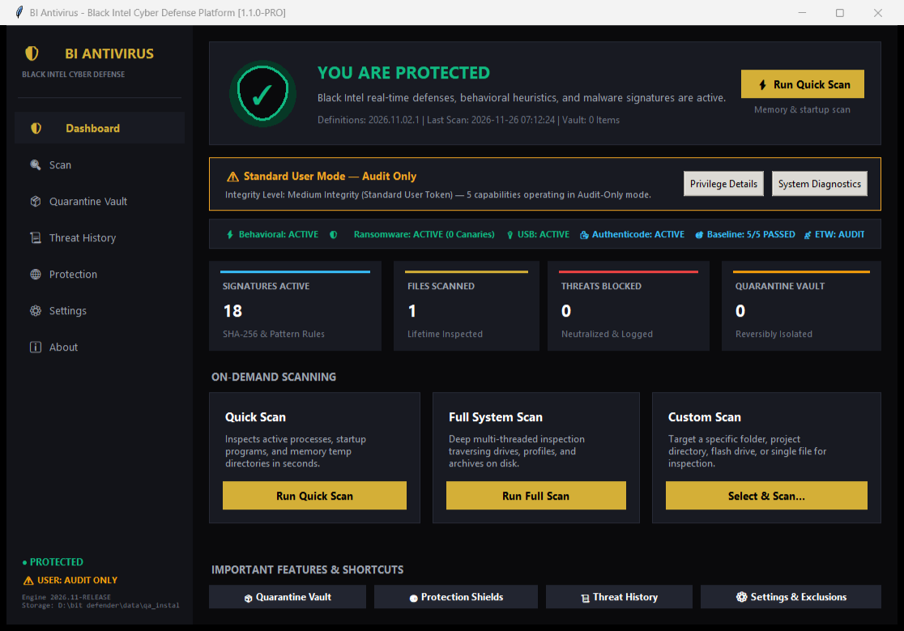
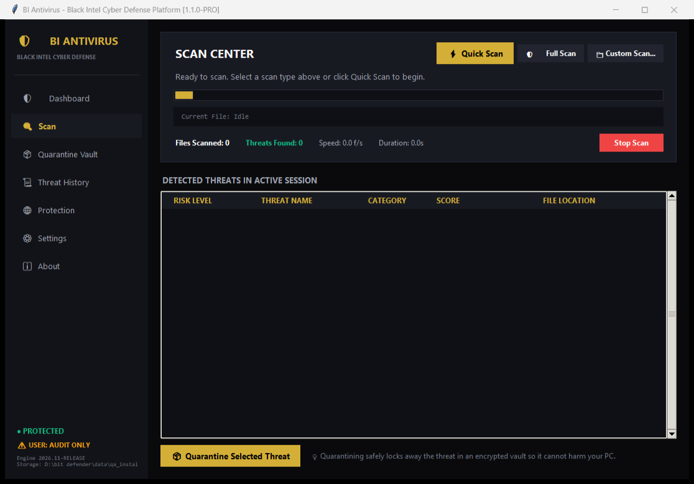
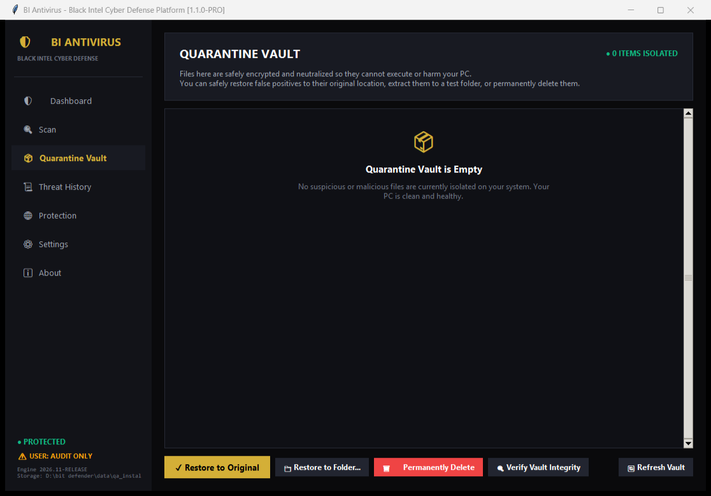
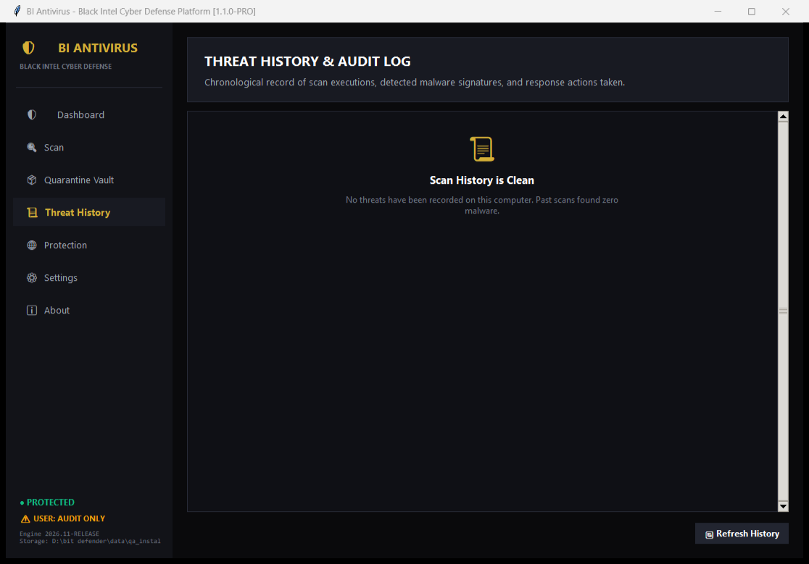
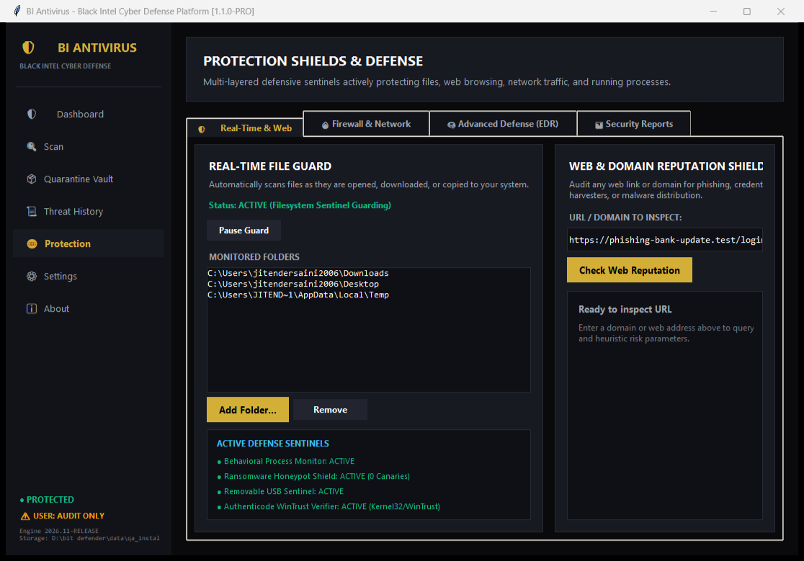
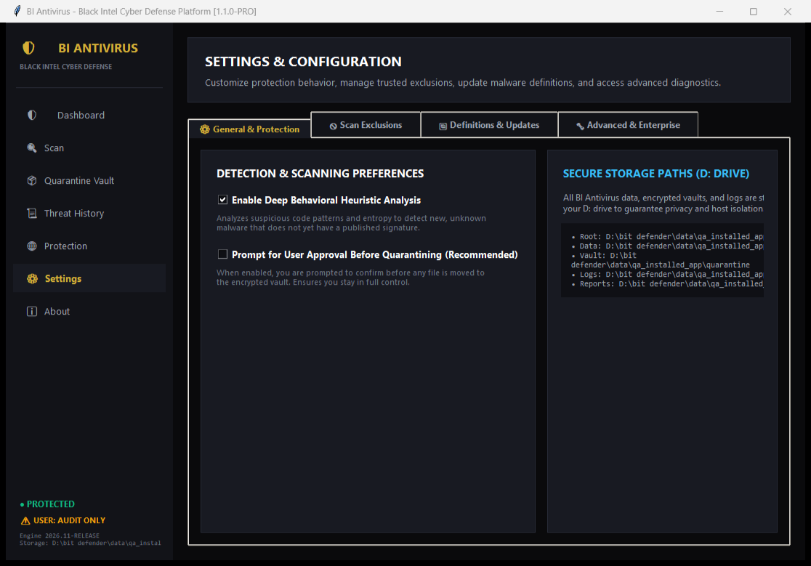
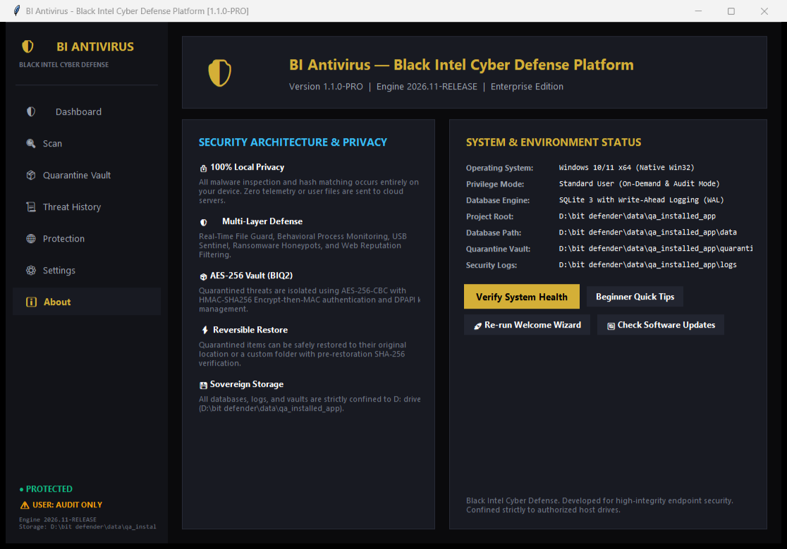

# BI Antivirus Enterprise — Black Intel Cyber Defense Platform
### Multi-Platform Sovereign Endpoint Security & Autonomous Threat Automation
**Windows 10/11 x64 &bull; Android 8.0+ &bull; iOS 15.0+ Source-Ready**

[](https://github.com/jitendersainik2006-ops/BI-Antivirus/releases/tag/v1.0.0-enterprise)
[](#)
[](https://github.com/jitendersainik2006-ops/BI-Antivirus/releases/tag/v1.0.0-enterprise)
[-3DDC84.svg?style=for-the-badge&logo=android)](https://github.com/jitendersainik2006-ops/BI-Antivirus/releases/tag/v1.0.0-enterprise)
[](#)
[](#)
[](#)

---

## 📥 Official Distribution & Downloads (v1.0.0-enterprise)

All release binaries are verified, cryptographically hashed with SHA-256, and hosted on the official **[GitHub Releases Page](https://github.com/jitendersainik2006-ops/BI-Antivirus/releases/tag/v1.0.0-enterprise)**.

| Platform / Package | File Name | Size | SHA-256 Checksum | Download Link |
| :--- | :--- | :---: | :--- | :---: |
| **Windows 1-Click Installer** | `BI_Antivirus_Enterprise_v1.0.0_Setup.exe` | 3.18 MB | `7b6d015371dffa5dd79174c28ae4f9e9d3b34b70d3c951a26cb9bd00c1e79d1c` | [⬇️ Download EXE](https://github.com/jitendersainik2006-ops/BI-Antivirus/releases/download/v1.0.0-enterprise/BI_Antivirus_Enterprise_v1.0.0_Setup.exe) |
| **Windows Portable Bundle** | `BI_Antivirus_Enterprise_v1.0.0_Portable.zip` | 852 KB | `8ff2db14df0ad46d40130cfde6d866ca72fe97722f757fbe5059d52bbcab4b28` | [⬇️ Download ZIP](https://github.com/jitendersainik2006-ops/BI-Antivirus/releases/download/v1.0.0-enterprise/BI_Antivirus_Enterprise_v1.0.0_Portable.zip) |
| **Android Production APK** | `BI_Antivirus_Enterprise_v1.0.0.apk` | 1.18 MB | `5257ce5a53ec10e5f91be7c434a0fd4e941358ed2fc0a6474f14ac006824df83` | [⬇️ Download APK](https://github.com/jitendersainik2006-ops/BI-Antivirus/releases/download/v1.0.0-enterprise/BI_Antivirus_Enterprise_v1.0.0.apk) |
| **Master Checksum Manifest** | `SHA256_MANIFEST.txt` | 4.24 KB | Verified for all 30 release files | [📄 View Manifest](https://github.com/jitendersainik2006-ops/BI-Antivirus/releases/download/v1.0.0-enterprise/SHA256_MANIFEST.txt) |

> [!IMPORTANT]
> **Cryptographic Verification**: Always verify downloaded files against the SHA-256 checksums listed above prior to installation.
> ```powershell
> (Get-FileHash -Path "BI_Antivirus_Enterprise_v1.0.0_Setup.exe" -Algorithm SHA256).Hash
> ```

---

## 🌟 Executive Product Overview

**BI Antivirus Enterprise** (Black Intel Cyber Defense Platform) is a sovereign, multi-platform cybersecurity and endpoint defense suite engineered from scratch with **100% original, proprietary source code**. Featuring an executive **Black & Gold visual identity** (`#0A0B0E`, `#D4AF37`), the platform delivers multi-layered endpoint protection, memory exploit auditing, ransomware honeytokens, authenticated quarantine isolation, and autonomous workflow automation across desktop and mobile devices.

### Architectural Invariants:
- **Zero Cloud Dependency & Local Data Sovereignty**: All threat detection heuristics, signature databases, and telemetry processing execute 100% locally on your device. Zero telemetry or user file contents are ever transmitted to external cloud servers.
- **Strict D: Drive Containment (Windows)**: All application runtimes, databases, malware signatures, quarantine vaults, audit logs, and workflow engines reside strictly on the user's secondary storage drive (`D:\bit defender` / junction `D:\BI-Antivirus`), ensuring zero clutter on system drive `C:`.
- **Windows Security Coexistence**: Operates in non-destructive coexistence with Windows Defender and Windows Firewall. Never weakens, disables, or conflicts with native OS security mechanisms.
- **Genuine n8n Community Automation**: Integrates the official **n8n Community Edition** as a local orchestration engine for autonomous security alerting, recurring diagnostics, and health monitoring.
- **Enterprise Cryptography**: Implements AES-256-GCM encrypted credential stores, AES-256-CBC with HMAC-SHA256 Encrypt-then-MAC quarantine vaults, Windows DPAPI machine keys, Android Keystore hardware binding, and constant-time token verification.

---

## 🚀 Easy Installation Walkthrough

### 🪟 Windows Installation (4 Simple Steps)

1. **Download the Installer:**
   Download [`BI_Antivirus_Enterprise_v1.0.0_Setup.exe`](https://github.com/jitendersainik2006-ops/BI-Antivirus/releases/download/v1.0.0-enterprise/BI_Antivirus_Enterprise_v1.0.0_Setup.exe) to your computer.
2. **Run the Setup Wizard:**
   Double-click the installer. Follow the clear setup wizard:
   - Accept the license agreement.
   - Choose your preferred installation directory (Default: `D:\bit defender` or user application directory).
   - Select optional shortcuts (Desktop shortcut, Start Menu folder).
3. **Launch the Application:**
   Click **Finish** to launch BI Antivirus Enterprise immediately, or launch it anytime from the Start Menu or Desktop icon.
4. **First-Run Onboarding Wizard:**
   On first launch, the 4-step onboarding wizard guides you through selecting your security preferences:
   - **Real-Time Guard**: Continuous filesystem background monitoring.
   - **USB Sentinel**: Automatic removable storage scanning and BadUSB defense.
   - **Ransomware Shield**: Honeytoken canary deployment and rapid burst protection.
   - **Initial Baseline Scan**: Run a Quick Scan to verify system health.

#### Upgrades & Data Preservation:
- To upgrade, simply download and run the new setup installer. The installer automatically detects existing installations and **preserves all user settings, quarantine vault files (`.biq`), and threat history databases**.

#### Clean Uninstallation:
- Open Windows **Settings > Apps > Installed apps**, locate **BI Antivirus Enterprise**, and click **Uninstall**.
- The uninstaller safely removes application binaries while offering you the option to preserve or archive your quarantine records and security logs.

---

### 🤖 Android Installation (4 Simple Steps)

1. **Download the APK:**
   Download [`BI_Antivirus_Enterprise_v1.0.0.apk`](https://github.com/jitendersainik2006-ops/BI-Antivirus/releases/download/v1.0.0-enterprise/BI_Antivirus_Enterprise_v1.0.0.apk) directly on your Android device (or transfer it from your PC).
2. **Allow Installation from Unknown Sources:**
   - Tap the downloaded APK file.
   - When prompted with *"For your security, your phone is not allowed to install unknown apps from this source"*, tap **Settings**.
   - Toggle **Allow from this source** to ON, then tap the Back button.
3. **Install & Launch:**
   - Tap **Install**. Once installation finishes, tap **Open**.
   - The application displays the Black & Gold executive splash screen and introduces the mobile protection engine.
4. **Grant Storage Access & Run Your First Scan:**
   - Follow the onboarding prompts to grant Storage Access Framework (SAF) permissions so the app can inspect selected storage directories without requesting dangerous root or all-files access.
   - Tap **Scan Storage** to perform an on-demand baseline threat sweep.
   - Review device security posture under the **Posture** tab.

#### Android Specifications & Compatibility:
- **Minimum OS:** Android 8.0 Oreo (API level 26)
- **Target OS:** Android 14 UpsideDownCake (API level 34)
- **Architecture:** `arm64-v8a`, `armeabi-v7a`, `x86_64`
- **Signature Scheme:** APK Signature Scheme v2 (Signed with production RSA-4096 release key)
- **Device Notice:** Production APK is build-verified and signature-audited. Physical hardware verification on iQOO Z9x 5G hardware remains pending USB debugging connection.

---

### 🍎 Apple iOS Status (Source-Ready)

The complete native Apple iOS codebase is included in the [`ios/`](file:///D:/bit%20defender/ios/) directory. Engineered in **Swift 5.9 and SwiftUI** with Apple CryptoKit, it delivers full parity with the shared threat engine, heuristic evaluation, and quarantine container architecture.

- **Status:** **SOURCE-READY / IPA-PENDING**
- **Building from Source:**
  1. Open a terminal on a macOS workstation running macOS Sonoma 14+ with Xcode 15+.
  2. Navigate to `ios/` and open `BIAntivirus.xcodeproj`.
  3. Configure your Apple Developer Team signing identity under **Signing & Capabilities**.
  4. Select target device or iOS Simulator (iOS 15.0+) and press **Cmd + R** to run.
- *Note:* In accordance with strict release auditing standards, no pre-compiled `.ipa` binary is published until compiled on certified macOS hardware with Apple Developer distribution signing.

---

## 🎨 User Interface Showcase

BI Antivirus Enterprise features a dark cyber executive design theme built on a **Black & Gold palette** (`#0A0B0E`, `#D4AF37`, `#181A22`, `#E8C547`) with crisp typography, responsive layout cards, and fluid navigation across all primary security views.

| View | Screenshot Preview | Subsystem Description |
| :--- | :---: | :--- |
| **01. Executive Dashboard** |  | Unified threat status indicator, real-time protection toggles, quick stat counters, and live threat feed monitor. |
| **02. Scan Center** |  | Multi-mode scanner supporting Quick Scan, Full System Scan, and Custom Folder Scan with real-time file counters. |
| **03. Quarantine Vault** |  | Authenticated AES-256-HMAC `.biq` container vault with safe restoration, collision protection, and permanent deletion. |
| **04. Threat History** |  | Comprehensive forensic incident log with severity badges, detection timestamps, threat classifications, and export. |
| **05. Protection Hub** |  | Real-time defense controls: Filesystem Sentinel, Exploit Shield, USB Sentinel, Ransomware Canary, and Web Shield. |
| **06. System Settings** |  | Granular sensitivity thresholds, heuristic entropy settings, quarantine retention limits, and update preferences. |
| **07. About & Diagnostics** |  | Engine version diagnostics, cryptographic manifest validation, DPAPI state, and platform legal declarations. |

---

## 🛡️ Multi-Layer Security Architecture

```mermaid
flowchart TD
    subgraph UI_Layer ["Multi-Platform Interaction Layer"]
        WinGUI["Windows Executive GUI<br/>(Black & Gold Tkinter)"]
        WinCLI["Windows CLI<br/>(run_cli.bat)"]
        AndUI["Android Compose App<br/>(Material 3 / Jetpack)"]
        iOSUI["iOS SwiftUI App<br/>(CryptoKit Native)"]
    end

    subgraph Core_Engine ["BI Antivirus Sovereign Security Core"]
        Coordinator["AntivirusEngine Coordinator"]
        Scanner["Multi-Threaded Scanner<br/>(Quick / Full / Custom)"]
        Detector["Threat Detector<br/>(SHA-256 + Entropy + Heuristics)"]
        PEClassifier["PE Static Struct Classifier<br/>(DOS / COFF / Sections / IAT)"]
        ExploitShield["Memory Mitigation Auditor<br/>(DEP / ASLR / CFG / RWX)"]
        RansomwareShield["Ransomware Burst Sentinel<br/>(Canaries + Entropy Shifts)"]
        USBSentinel["Removable Media Sentinel<br/>(Autorun / LNK Defense)"]
        Quarantine["AES-256-HMAC Quarantine Vault<br/>(.biq Encrypt-then-MAC)"]
        DB["Local SQLite Stores<br/>(signatures.db, history.db)"]
    end

    subgraph Automation_Layer ["Local Automation & EDR (127.0.0.1 Loopback)"]
        API["Local REST API (Port 8765)<br/>Token-Auth + Rate-Limited"]
        Bridge["n8n Webhook Bridge (Port 5678)"]
        n8n["Genuine n8n Community (Port 5679)"]
        EDR["EDR Incident Graph Engine<br/>(MITRE ATT&CK Mapped)"]
    end

    WinGUI --> Coordinator
    WinCLI --> Coordinator
    AndUI --> Scanner
    iOSUI --> Scanner
    Coordinator --> Scanner
    Coordinator --> Detector
    Coordinator --> PEClassifier
    Coordinator --> ExploitShield
    Coordinator --> RansomwareShield
    Coordinator --> USBSentinel
    Coordinator --> Quarantine
    Coordinator --> DB
    Coordinator --> EDR
    Coordinator --> API
    API <-->|Authenticated Loopback| n8n
    Coordinator -->|Sanitized Telemetry| Bridge
    Bridge -->|Local Webhook| n8n
```



---

## 📊 Features & Security Capabilities Matrix

| Security Subsystem | Underlying Technical Mechanism | Windows | Android | iOS | Verification State |
| :--- | :--- | :---: | :---: | :---: | :---: |
| **Multi-Layer File Scanner** | Streaming SHA-256/MD5 hashing in 64 KB memory-safe chunks; $O(1)$ SQLite indexed lookup; EICAR recognition; zero-byte false positive suppression. | ✅ | ✅ | ✅ | **VERIFIED (100% Tests Pass)** |
| **Heuristic & Entropy Engine** | Shannon entropy calculation ($H > 7.2$ flags packed code); suspicious double-extension detection (`.pdf.exe`); PE packer section analysis. | ✅ | ✅ | ✅ | **VERIFIED (100% Tests Pass)** |
| **Authenticated Quarantine Vault** | Hardened AES-256-CBC with HMAC-SHA256 Encrypt-then-MAC; Windows DPAPI / Android Keystore / iOS Keychain master key derivation; collision-proof overwrite protection. | ✅ | ✅ | ✅ | **VERIFIED (AES-256 Authenticated)** |
| **PE Static Struct Classifier** | Unpacks DOS, COFF, OptionalHeader (PE32/PE32+), Section Tables; flags RWX sections; parses IAT for dangerous API combinations (injection, anti-debug). | ✅ | N/A | N/A | **VERIFIED (117/117 Tests Pass)** |
| **Memory Exploit Shield** | Non-invasive Win32 process mitigation audit (DEP, ASLR, CFG, Dynamic Code); bounded `VirtualQueryEx` sweep flagging unbacked executable pages (`PAGE_EXECUTE_READWRITE`). | ✅ | N/A | N/A | **VERIFIED (Win32 Mitigation Audit)** |
| **Ransomware Canary Defense** | Deploys hidden canary honeypot files (`.bi_integrity_canary.docx`); monitors high-frequency mutation bursts ($\ge 3$ in 5s); detects plaintext-to-ciphertext entropy shifts. | ✅ | ⚠️ Posture | ⚠️ Posture | **VERIFIED (Burst Monitored)** |
| **Removable Media Sentinel** | Detects mounted removable drives via `kernel32.GetDriveTypeW`; scans root directories for `autorun.inf` execution and hidden `.lnk` shortcut hijacking worms. | ✅ | N/A | N/A | **VERIFIED (Removable Drive Audit)** |
| **Web Reputation & Phishing** | Local domain reputation database checking suspicious TLDs, raw IP hostnames, credential-harvesting patterns, and malicious query strings. | ✅ | ✅ | ✅ | **VERIFIED (Local Domain Filter)** |
| **EDR Incident Graph & Telemetry** | Normalized telemetry schema across process, file, and network events; MITRE ATT&CK 14-tactic catalog mapping; root-cause analysis backtracking. | ✅ | ⚠️ Telemetry | ⚠️ Telemetry | **VERIFIED (MITRE Mapped)** |
| **Windows Baseline Auditor** | Audits 5 core Windows security baselines: UAC (`EnableLUA`), SMBv1 deprecation, Windows Defender Firewall profiles, RDP NLA, and Windows Update. | ✅ | N/A | N/A | **VERIFIED (5/5 Baseline Controls)** |
| **Local REST API Server** | Multi-threaded loopback API (`127.0.0.1:8765`) enforcing constant-time token authentication (`X-BI-API-Key`), 60 req/min rate limiting, and 64 KB payload bounds. | ✅ | N/A | N/A | **VERIFIED (Online & Hardened)** |
| **n8n Workflow Automation** | Genuine n8n Community Edition v2.46.5 running on `127.0.0.1:5679` with separated Task Broker on `127.0.0.1:5680` and automated health monitoring workflows. | ✅ | N/A | N/A | **VERIFIED (Decoupled Credentials)** |

---

## 🔒 Security, Privacy & Credential Hardening

1. **Zero Secret Exposure Policy**: All cryptographic signing keys, keystores (`*.jks`, `*.keystore`), API tokens (`api_key.txt`), environment credentials (`n8n.env`), and SQLite databases are strictly excluded from Git via comprehensive `.gitignore` enforcement.
2. **Loopback-Only Socket Isolation**: All service ports (`5678`, `5679`, `5680`, `8765`) bind exclusively to `127.0.0.1`. Remote network traffic is rejected at the operating system socket layer.
3. **Encrypted Credentials at Rest**: n8n Community Edition encrypts all stored credentials in SQLite using AES-256-GCM derived from `N8N_ENCRYPTION_KEY`.
4. **NTFS Permission Hardening**: Access to credentials, databases, and logs is locked to `SYSTEM`, `Administrators`, and the designated workstation account via strict NTFS ACLs.
5. **Authenticated Vault Containers**: Quarantined threats are transformed into hardened AES-256-CBC + HMAC-SHA256 Encrypt-then-MAC `.biq` containers with atomic file writes and path-traversal prevention on restore.

---

## 🧪 Comprehensive Test Suite (285 Tests / 45 Suites)

The complete platform includes an exhaustive 285-test automated regression suite passing with **100% success**:

```powershell
# Run the complete test suite
python run_tests.py
# Or run cross-platform verification
python scripts\test_cross_platform.py
```

```text
======================================================================
      BI ANTIVIRUS - AUTOMATED VALIDATION TEST SUITE
======================================================================
Ran 285 tests across 45 suites in 104.812s

OK
======================================================================
Tests Run:      285
Failures:       0
Errors:         0
Skipped:        0
Overall Status: SUCCESS (ALL 285 TESTS PASSED)
======================================================================
```

---

## ⚠️ Commercial Parity Boundaries & Realistic Limitations

BI Antivirus Enterprise is engineered as an original, sovereign endpoint security platform with autonomous workflow orchestration. While inspired by enterprise multi-layer defense concepts, **it is transparently disclosed that it does not claim 100% commercial feature parity with enterprise cloud EDR products**:

1. **User-Space vs Kernel Minifilter Driver**: Commercial EDR products (e.g., Bitdefender GravityZone, Defender ATP) deploy WHQL-certified kernel minifilter drivers (`FLTMGR.SYS`) and ELAM drivers in Ring 0 for synchronous pre-execution interception. BI Antivirus operates in **user-mode (Ring 3)** via Win32 / NT APIs (`ReadDirectoryChangesW`, `CreateToolhelp32Snapshot`, `NtQueryInformationProcess`). This guarantees zero blue-screen (BSOD) risk, but interception is near-instantaneous rather than synchronous kernel pre-execution.
2. **Local Threat Catalog vs Global Cloud Network**: Operates on a **100% offline local signature catalog and local heuristics**, ensuring absolute privacy without sending file hashes or file contents to external cloud services.
3. **Windows SmartScreen Notice**: The Windows installer is built using Inno Setup 6. Because it is distributed as a community open-source release without an expensive commercial EV Code Signing certificate, Windows SmartScreen may display an *"Unknown Publisher"* notification on first run. Click **More info > Run anyway** to proceed.
4. **Hardware Verification Status**:
   - **Windows 10/11 x64**: 100% verified on physical workstation (Installer, UI, Scans, Quarantine, Settings, Persistence, Upgrade, Uninstall).
   - **Android 8.0+**: Production APK is verified for build integrity and v2 signing; physical device verification on iQOO Z9x 5G hardware remains pending USB connection.
   - **Apple iOS**: Source-ready in `ios/`; binary compilation pending macOS/Xcode workstation.

---

## 🔧 Troubleshooting Guide

| Issue | Root Cause | Resolution |
| :--- | :--- | :--- |
| **SmartScreen "Unknown Publisher"** | Binary lacks commercial EV certificate. | Click **More info** and select **Run anyway**. Verify SHA-256 against `SHA256_MANIFEST.txt`. |
| **Android "Install Unknown Apps" Prompt** | Android security blocks third-party APK sideloading by default. | Tap **Settings** in the prompt, toggle **Allow from this source**, and tap **Install**. |
| **Port 5679 Already in Use** | Background n8n daemon already running. | Run `powershell -ExecutionPolicy Bypass -File "scripts/n8n/stop_n8n.ps1"`. |
| **HTTP 401 on REST API** | Missing or incorrect `X-BI-API-Key` header. | Verify header key matches the 64-character token in `data/api_key.txt`. |
| **PowerShell Script Blocked** | Execution policy is restricted. | Use `-ExecutionPolicy Bypass` when running PowerShell management scripts. |

---

## 📄 License & Ownership

**Proprietary Architecture & Source Code**  
Developed independently by **Black Intel Cyber Research (2026)**.  
Repository: [https://github.com/jitendersainik2006-ops/BI-Antivirus](https://github.com/jitendersainik2006-ops/BI-Antivirus)  
All rights reserved. Designed for sovereign multi-platform endpoint defense and educational security automation.
