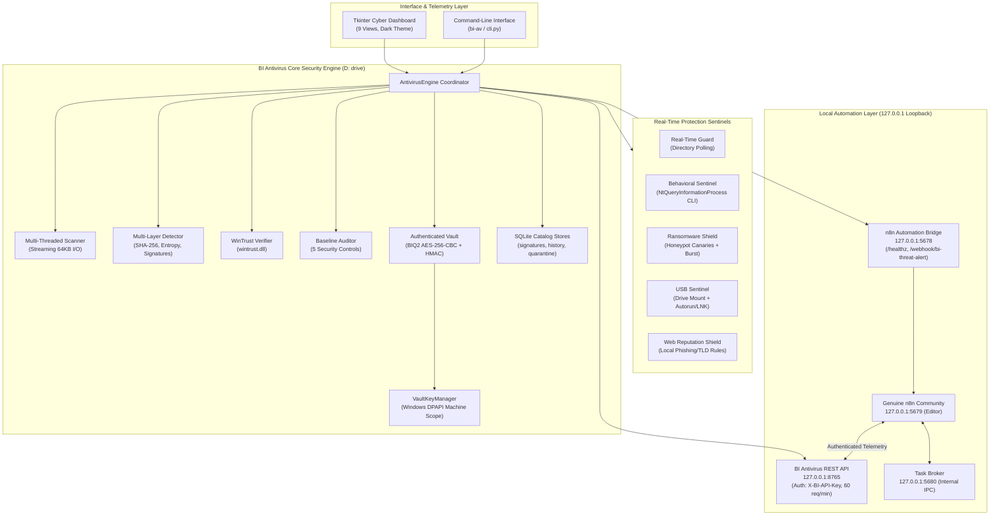

# BI Antivirus — Technical Architecture & Engineering Specification

## 1. Architectural Philosophy & Design Principles

**BI Antivirus** (Black Intel Cyber Defense Platform) is an independently designed, modular Windows endpoint security and security automation platform. It is engineered with three non-negotiable architectural mandates:

1. **User-Space Safety & Non-Destructive Operation**: Operates purely in Windows User-Mode (Ring 3). It utilizes standard Win32, NT, and Crypto APIs (`bcrypt.dll`, `crypt32.dll`, `wintrust.dll`, `ntdll.dll`, `kernel32.dll`). It introduces **zero kernel stability risks**, causes no Blue-Screen-of-Death (BSOD) failures, and never disables or tampers with native Windows Defender.
2. **Strict Drive D: Containment & Local Data Sovereignty**: All application runtimes, databases, malware signatures, quarantine vaults, audit logs, and workflow engines reside strictly on `D:\bit defender` (junction `D:\BI-Antivirus`). Zero operational files or user data are stored on `C:`.
3. **Decoupled Local Orchestration**: Leverages the official, unmodified **n8n Community Edition (v2.46.5)** as a sovereign local workflow broker. Communication occurs strictly over loopback (`127.0.0.1`), with credentials encrypted at rest using AES-256-GCM and segregated process execution.

---

## 2. Component Topology & Data Flow

---

## 3. Core Subsystems & Mechanisms

### 3.1 Detection & Heuristics Engine
- **Streaming Hashes**: Computes SHA-256 and MD5 using 64 KB memory-safe blocks, keeping peak memory consumption below 35 MB regardless of file size.
- **Shannon Byte Entropy**: Evaluates byte distribution randomness:
  $$H(X) = -\sum_{i=1}^{n} P(x_i) \log_2 P(x_i)$$
  Values where $H > 7.2$ on executable binaries flag packed, encrypted, or obfuscated droppers.
- **PE Packer Heuristics**: Section table analysis flags known compression stubs (`.upx0`, `.aspack`, `.themida`, `.mpress`).
- **Authenticode Verification**: Direct interop with Windows `wintrust.dll` via `WinVerifyTrust` and `WINTRUST_ACTION_GENERIC_VERIFY_V2` checks digital certificate chains without external tools.

### 3.2 Authenticated Quarantine Vault (`BIQ2`)
- **Cipher**: AES-256-CBC with PKCS#7 block padding via native Windows CNG (`bcrypt.dll`).
- **MAC**: HMAC-SHA256 Encrypt-then-MAC computed over `Header (5B) || IV (16B) || Ciphertext (NB)`.
- **Key Derivation**: HKDF-style domain separation from a 256-bit Master Key:
  - `K_enc = HMAC-SHA256(MasterKey, b"BI_QUARANTINE_AES_KEY_v2")`
  - `K_mac = HMAC-SHA256(MasterKey, b"BI_QUARANTINE_HMAC_KEY_v2")`
- **Master Key Security**: Stored encrypted in `data/vault_master.dpapi` via `crypt32.CryptProtectData` with machine-level scope (`CRYPTPROTECT_LOCAL_MACHINE`) and restricted NTFS permissions.
- **Atomic Operations**: Employs `.biq.tmp` flushing and atomic rename (`os.replace`) to guarantee no corrupted partial writes.
- **Dual-Mode Backward Compatibility**: Checks the 4-byte magic `b"BIQ2"`. If absent, seamlessly decodes legacy v1 XOR records.

### 3.3 Behavioral Sentinel & Command-Line Telemetry
- **Process Hierarchy**: Native `CreateToolhelp32Snapshot` tracks parent-child process chains. Flags anomalous executions such as Office applications or Adobe Reader spawning shells (`powershell.exe`, `cmd.exe`, `mshta.exe`).
- **Live Command-Line Extraction**: Calls `ntdll.NtQueryInformationProcess` with `ProcessCommandLineInformation (60)`. Runs under standard user rights (`PROCESS_QUERY_LIMITED_INFORMATION = 0x1000`) in `0.23 ms`.
- **Ransomware Staging Detection**: Intercepts command-line patterns attempting shadow copy destruction (`vssadmin delete shadows`), backup catalog wiping (`wbadmin delete catalog`), or boot policy tampering (`bcdedit /set ignoreallfailures`).

### 3.4 Ransomware Honeypot & Mutation Sentinel
- **Integrity Canaries**: Deploys hidden decoy files (`.bi_integrity_canary.docx`) in active user folders. Monitored for modification, encryption, or deletion.
- **Burst Heuristic**: Tracks file write frequency. Renaming or modifying $\ge 3$ files with ransomware extensions (`.lockbit`, `.blackcat`, `.crypto`) within a 5.0-second rolling window triggers a critical burst alert.
- **Extortion Note Interception**: Regex scanning flags known ransom note patterns (`readme_to_decrypt.txt`, `restore_files.txt`).

### 3.5 5-Control Windows Baseline Security Assessment
Direct registry and service query evaluating 5 core baseline controls:
1. **User Account Control (UAC)**: `HKLM\SOFTWARE\Microsoft\Windows\CurrentVersion\Policies\System\EnableLUA == 1`.
2. **SMBv1 Deprecation**: `HKLM\SYSTEM\CurrentControlSet\Services\LanmanServer\Parameters\SMB1 == 0` (mitigates EternalBlue).
3. **Windows Defender Firewall**: Read-only verification that `EnableFirewall == 1` across Domain, Private, and Public profiles.
4. **Remote Desktop (RDP) Exposure**: `HKLM\SYSTEM\CurrentControlSet\Control\Terminal Server\fDenyTSConnections == 1` or NLA enforcement.
5. **Windows Update Service**: Service status audit verifying `wuauserv` is operational.

---

## 4. Local API & Automation Security

- **Socket Binding**: Strict `127.0.0.1` loopback binding on all ports (`8765`, `5678`, `5679`, `5680`). Non-loopback packets rejected at the socket layer.
- **Token Verification**: Loopback REST API requires HTTP header `X-BI-API-Key` validated via constant-time `hmac.compare_digest`.
- **Rate Limiting**: Sliding-window rate limiter enforces a maximum of 60 requests/minute.
- **Bounded Payloads**: Request body strictly capped at 64 KB.
- **n8n Isolation**: n8n runs as a decoupled process. The demonstration Health Monitor workflow (`ZIsNBbDMmjbASuu6`) is maintained in an **inactive state (`active = false`)**, manual-trigger only.
