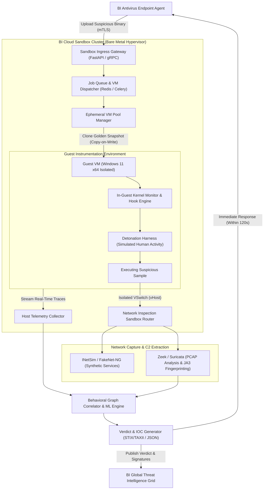
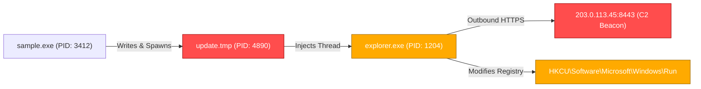

# BI Antivirus Enterprise — Engineering Specification: Cloud / Hypervisor Automated Sandbox
**Document ID:** SPEC-SND-003  
**Classification:** Enterprise Infrastructure & Threat Analytics  
**Target:** Automated Malware Detonation, Behavioral Graphing & C2 Extraction Subsystem  
**Standard:** NIST SP 800-83, Hyper-V WMI / QEMU-KVM Guest Agent Protocol

---

## 1. Executive Summary

Static signatures and lightweight local machine learning models are necessary for rapid triage but insufficient against advanced polymorphic droppers, multi-stage loaders, encrypted payloads, and evasive ransomware. Bitdefender GravityZone Cloud Sandbox provides isolated, automated execution environments to safely detonate suspicious binaries, record complete operating system API calls, intercept outbound C2 communications, and reconstruct full execution trees.

This specification details the architecture for the **BI Antivirus Automated Hypervisor Sandbox**. The system orchestrates lightweight, ephemeral virtual machine guests (Windows 10/11 x64) on dedicated hypervisor clusters (Hyper-V or QEMU/KVM), injecting instrumented API hooks, analyzing network activity across synthetic DNS/Internet sinks (INetSim / Suricata), and returning deterministic threat verdicts to endpoints within 120 seconds.

---

## 2. Distributed Detonation Architecture

---

## 3. Hypervisor Subsystem & Guest Isolation

### 3.1 Hypervisor Technology Selection
- **Primary Enterprise Backend:** Windows Server 2022/2025 **Hyper-V** with Nested Virtualization and Discrete Device Assignment (DDA).
- **Secondary / Linux Backend:** **QEMU / KVM** with `libvirt` and `virtio` paravirtualized storage for sub-second VM snapshot restoration.

### 3.2 Ephemeral Snapshot Lifecycle
1. **Golden Base Image:** Windows 11 Enterprise (Build 26100) pre-configured with Office, Acrobat Reader, Chrome, and common software libraries.
2. **Snapshot Creation:** Memory + disk state frozen while system is idle (`snapshot-create-as`).
3. **Detonation Spin-Up:** Instant copy-on-write diff overlay created in RAM disk (`/dev/shm` or Windows Storage Spaces NVMe). Spin-up time: `< 2.8 seconds`.
4. **Post-Detonation Teardown:** VM destroyed immediately; memory and overlay discarded. Zero persistence between detonations.

---

## 4. In-Guest Telemetry & Anti-Evasion Countermeasures

Advanced malware queries system attributes to detect virtualized environments. The BI Sandbox implements comprehensive anti-evasion countermeasures:

### 4.1 Anti-Analysis Hardening Matrix
| Evasion Vector | Attacker Query | Sandbox Countermeasure |
| :--- | :--- | :--- |
| **Hypervisor Artifacts** | `CPUID` hypervisor bit (ECX bit 31). | KVM CPUID masking / Hyper-V stealth flags (`hypervisor=off`). |
| **System Device Names** | `QEMU`, `VBOX`, `VMware` in device strings. | Synthetic ACPI tables, randomized vendor IDs, spoofed Dell/HP BIOS strings. |
| **Human Activity Timing** | Zero mouse movements, lack of user clicks. | Simulated mouse jitter, randomized window switching, document scrolling. |
| **Sleep / Delay Evasion** | `Sleep(600000)` (10-minute stalling). | Kernel `NtDelayExecution` and `GetTickCount64` time-acceleration patching. |
| **Screen Resolution** | Generic 800x600 or 1024x768 display. | Fixed 1920x1080 resolution with virtual monitor EDID profiles. |

---

## 5. Network Simulation & C2 Extraction

To observe second-stage payloads without exposing live systems to external botnets:
1. **Network Containment:** Guest VMs reside on isolated software-defined subnets (VLAN / VXLAN) with zero direct route to the Internet.
2. **Synthetic Services (FakeNet-NG / INetSim):**
   - **DNS:** Intercepts all DNS queries and responds with internal sinkhole IPs.
   - **HTTP/HTTPS:** Serves dynamic SSL certificates generated on the fly, replying with 200 OK to dropper GET/POST requests.
   - **SMTP / IRC / Tor:** Simulates command responses to elicit credential dumps or exfiltration attempts.
3. **Automated Protocol Extraction:**
   - Real-time PCAP capture.
   - JA3 / JA4 TLS fingerprinting of C2 handshakes.
   - Snort/Suricata rule matching against known botnet traffic.

---

## 6. Behavioral Graph Reconstruction & Scoring

The host collector aggregates raw event streams into a unified DAG (Directed Acyclic Graph):

### Risk Evaluation Engine:
- **Heuristic Indicators:**
  - Ingress dropper execution: +25
  - Process injection (`CreateRemoteThread`): +35
  - Persistence installation: +25
  - Hidden C2 beaconing: +35
- **Verdict Threshold:** Score $\ge 80 \implies \text{MALICIOUS}$, Score $50–79 \implies \text{SUSPICIOUS}$, Score $< 50 \implies \text{BENIGN}$.

---

## 7. Implementation Roadmap & Hardware Sizing

### 7.1 Sizing for 10,000 Managed Endpoints
- **Daily Submissions:** ~1,200 unknown files/day.
- **Detonation Window:** 90 seconds per sample.
- **Concurrent VMs Required:** 16 active execution slots.
- **Hardware Profile:**
  - 2x AMD EPYC 7763 (128 Cores / 256 Threads total).
  - 512 GB DDR4 ECC RAM.
  - 4x 3.84 TB Enterprise NVMe (RAID 10) for VM overlays.

---

## 8. Risk Analysis & Failure Modes

| Risk Scenario | Impact | Defensive Mitigation |
| :--- | :--- | :--- |
| **VM Escape Exploit (Zero-Day)** | Critical | Guest runs unprivileged; host enforces strict AppArmor/SELinux (Linux) or Windows Defender Hyper-V Isolated Containers; hypervisor hosts patched automatically. |
| **Denial of Service via Heavy Samples** | High | Hard per-sample resource quotas: max 2 CPU cores, 4 GB RAM, 120s timeout; kill switch triggered immediately on timeout. |
| **C2 Leakage to Real Targets** | Severe | Strict firewall rule blocking all egress traffic except internal sinkholes; no live packets touch the public internet. |
