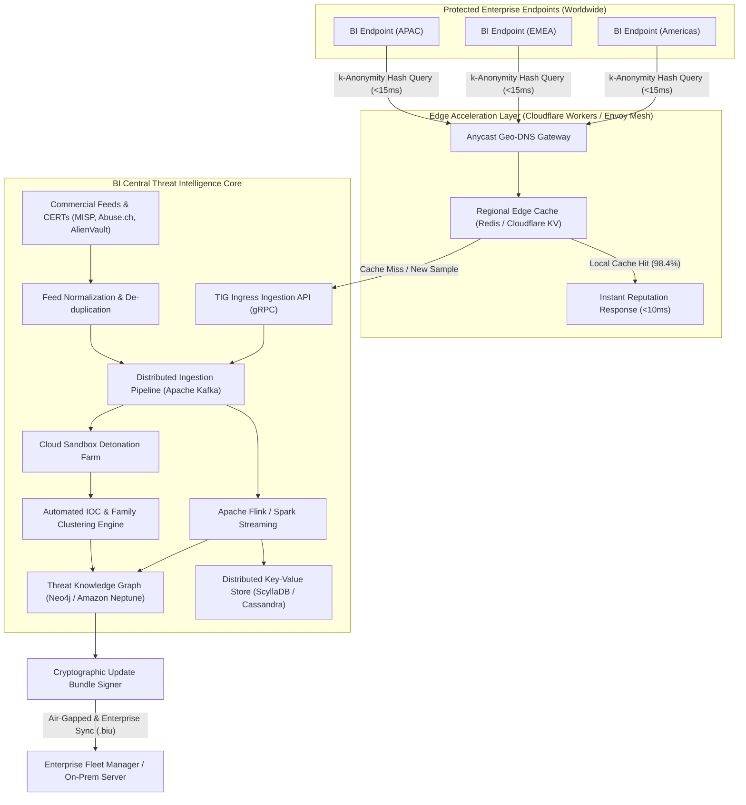

# BI Antivirus Enterprise — Engineering Specification: Global Threat Intelligence Grid (TIG)
**Document ID:** SPEC-TIG-004  
**Classification:** Global Infrastructure & Threat Intelligence Operations  
**Target:** High-Throughput Distributed Telemetry, Real-Time Hash Reputation & IOC Clustering Network  
**Standard:** STIX 2.1 / TAXII 2.1, RFC 7946, Bloom Filter Query Protocols

---

## 1. Executive Summary

Modern cyber threats operate at global velocities: phishing campaigns, credential abuse, and zero-day exploits emerge and mutate within minutes. Antivirus architectures relying exclusively on periodic signature updates (e.g. daily or weekly files) suffer from a dangerous protection latency window. Commercial solutions such as the Bitdefender Global Protective Network (GPN) query a centralized, highly optimized cloud network processing billions of queries daily with sub-10 millisecond response times.

This engineering specification establishes the architecture for the **BI Global Threat Intelligence Grid (TIG)**. It specifies a globally distributed, privacy-preserving reputation mesh capable of handling real-time hash, domain, and IP lookups, automated IOC ingestion from international CERTs, hierarchical graph clustering, and streaming cryptographic threat bundles back to air-gapped and enterprise on-premises nodes.

---

## 2. Global Cloud Architecture & Query Routing

---

## 3. Privacy-Preserving k-Anonymity Reputation Lookups

To uphold enterprise privacy and prevent passive surveillance of client file inventories, the BI Threat Intelligence Grid prohibits sending plaintext file paths, filenames, or full raw hashes for standard lookups.

### 3.1 Prefix-Matching k-Anonymity Protocol
1. **Hash Truncation at Endpoint:**
   - The endpoint computes the full SHA-256 of an unknown binary:  
     `H = SHA256(file) = 7d3a2b1c4e5f...9a`
   - The endpoint transmits only the **first 6 hexadecimal characters** (24 bits) to the edge node:  
     `Prefix = "7d3a2b"`
2. **Server-Side Candidate Retrieval:**
   - The regional edge cache looks up all known malicious or benign hashes matching prefix `7d3a2b` (typically 10 to 50 entries).
   - Returns the list of matching suffixes along with their reputation tags, confidence scores, and threat families.
3. **Local Resolution:**
   - The endpoint agent checks whether its complete hash exists within the returned suffix set.
   - **Privacy Guarantee:** The cloud server never learns which specific file was present on the client machine.

---

## 4. Scalable Storage & Database Architecture

At commercial scale (100 million+ active hashes, 500 million reputation records), database access requires tiered storage optimizations:

| Storage Tier | Technology | Purpose | SLA / Latency |
| :--- | :--- | :--- | :--- |
| **L1: Edge RAM Cache** | Memory-mapped Bloom Filters | Instant determination if a hash is definitely unknown or potentially known. | `< 0.2 ms` |
| **L2: Regional Distributed Cache** | Redis Cluster (Sharded) | High-frequency lookups of top 5 million active threats and whitelisted binaries. | `< 3 ms` |
| **L3: Persistent Primary Store** | ScyllaDB (C++ Cassandra re-write) | Multi-master, linear write scalability for full 500M+ hash reputation database. | `< 12 ms` |
| **L4: Relationship Graph** | Neo4j Enterprise | Threat attribution, actor tracking, and campaign infrastructure correlation. | Complex Query |

---

## 5. Automated IOC Ingestion & Family Clustering Engine

Raw IOC feeds from commercial vendors and open-source intelligence (OSINT) suffer from high duplication rates and false positives. The BI TIG pipeline applies automated normalization:

### 5.1 Ingestion Pipeline Stages
1. **Deduplication & Canonicalization:**
   - Domains converted to standard lowercase punycode.
   - IPv4/IPv6 validated and stripped of private/RFC 1918 ranges.
   - URLs sanitized and stripped of transient tracking tokens.
2. **Confidence Decay Algorithm:**
   - Threat indicators naturally expire. The engine applies an exponential decay function:
     $$\text{Confidence}(t) = \text{InitialConfidence} \times e^{-\lambda (t - t_0)}$$
   - Where $\lambda = \frac{\ln(2)}{\text{HalfLife}}$. Half-life for C2 domains: 7 days; for malicious file hashes: 180 days.
3. **Behavioral Clustering (DBSCAN / Graph Community Detection):**
   - Correlates shared TLS certificates, compiler watermarks, import table hashes (ImpHash), and C2 IP subnets.
   - Automatically groups disparate samples into common threat families (e.g. *LockBit 3.0*, *CobaltStrike*, *AgentTesla*).

---

## 6. Enterprise Air-Gapped Synchronization

For sovereign defense, banking, and critical infrastructure environments that forbid direct outbound internet connections:
1. **Hierarchical Proxy / Local TIG Mirror:**
   - An on-premises enterprise Fleet Manager connects securely via mTLS to the BI Central TIG.
   - Downloads differential cryptographic updates (`.biu` format) containing newly identified threats within the last 60 minutes.
2. **Offline Air-Gap USB Import:**
   - For air-gapped SCADA/ICS networks, weekly full bundles are exported to encrypted, signed storage media.
   - Enforces monotonic sequence numbers to mathematically prevent replay or rollback attacks.

---

## 7. Operational Metrics & SLA Commitments

- **Query Availability:** 99.999% uptime (multi-region active-active deployment).
- **Edge Response Latency:** P95 `< 15 ms`, P99 `< 35 ms`.
- **New Zero-Day Ingestion Velocity:** Under 4 minutes from sandbox detonation verdict to global edge propagation.
- **False Positive Target:** $< 0.0001\%$ across major OS system libraries and certified software publishers.

---

## 8. Risk Management & Mitigations

| Identified Risk | Severity | Engineered Mitigation |
| :--- | :--- | :--- |
| **DDoS on Central Query Gateways** | Critical | Cloudflare / Fastly Anycast edge routing with automated rate-limiting, SYN-flood absorption, and edge token verification. |
| **Poisoning of Threat Intelligence Feeds** | High | Multi-source corroboration consensus (requires agreement from $\ge 2$ trusted sources before auto-blocking); manual analyst review trigger for high-volume binaries. |
| **Outdated Edge Cache Serving Stale Allow** | Medium | Event-driven cache invalidation via Redis Pub/Sub; critical threat declarations broadcast globally within 1.5 seconds. |
