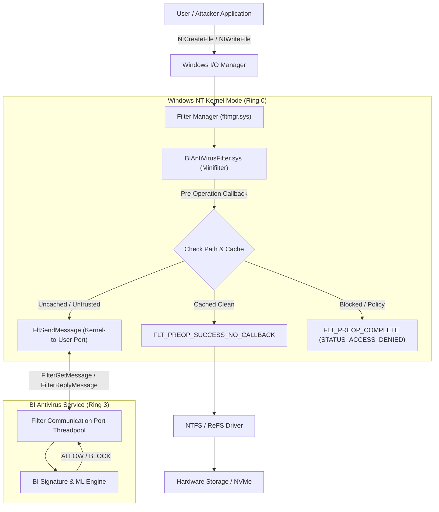

# BI Antivirus Enterprise — Engineering Specification: Commercial Kernel Minifilter Driver
**Document ID:** SPEC-KRN-001  
**Classification:** Proprietary Defensive Architecture  
**Target:** Windows File System Minifilter Driver (`BIAntiVirusFilter.sys`)  
**Standard:** Windows Filter Manager (`fltmgr.sys`), Microsoft WDK (Windows Driver Kit)

---

## 1. Executive Summary

In user-space antivirus software, file system inspection operates post-facto: file creation notifications via Win32 `ReadDirectoryChangesW` or survey scans trigger *after* the file handle has already been opened or modified. To achieve parity with Bitdefender GravityZone and tier-1 enterprise EDR solutions, BI Antivirus requires a kernel-mode file system minifilter driver registered with the Windows Filter Manager (`fltmgr.sys`). 

This specification defines the complete architectural design, I/O dispatch mechanisms, Altitude registration, pre-operation blockades, and inter-process communication (IPC) for `BIAntiVirusFilter.sys`. It enables true **synchronous, pre-execution interception** (`IRP_MJ_CREATE`, `IRP_MJ_SET_INFORMATION`, `IRP_MJ_WRITE`), eliminating race conditions and TOCTOU (Time-of-Check to Time-of-Use) vulnerabilities inherent in user-mode on-access monitors.

---

## 2. Architecture & Filter Pipeline

The minifilter integrates directly into the Windows Filter Manager stack below user applications and above disk device drivers.



---

## 3. Windows API & System Requirements

### 3.1 Kernel Dependencies & Subsystems
- **Windows Driver Framework:** Windows Driver Kit (WDK) 10.0.26100+ for Windows 10/11 & Server 2019/2022.
- **Filter Manager Interface:** `fltKernel.h` (Linked with `fltMgr.lib`).
- **Target Architecture:** `x64` and `ARM64`.
- **Target OS Range:** Windows 10 Version 1809 (Build 17763) up to Windows 11 Build 26100+ and Windows Server 2025.

### 3.2 Registered Altitude & Filter Registration
In accordance with Microsoft Windows Filter Manager Altitude Allocations:
- **Filter Load Order Group:** `FSFilter Anti-Virus`
- **Altitude Range:** `320000 - 329999`
- **Illustrative Requested Altitude:** `326450` *(Subject to Microsoft formal assignment)*
- **Driver Name:** `BIAntiVirusFilter.sys`
- **Service Name:** `BIAntiVirusFlt`

> [!IMPORTANT]
> **Microsoft Altitude Assignment Notice:** The altitude `326450` represents a proposed illustrative allocation within the official Microsoft antivirus altitude band. Filter altitudes are assigned exclusively by Microsoft Corporation upon formal submission via the Windows Filter Altitude Request process. Altitudes cannot be self-assigned or assumed approved.

### 3.3 Core Filter Manager API Functions
| Function | Purpose |
| :--- | :--- |
| `FltRegisterFilter` | Registers the minifilter driver with the Filter Manager. |
| `FltStartFiltering` | Begins processing I/O requests on attached volumes. |
| `FltCreateCommunicationPort` | Establishes a bidirectional secure communication port for Ring 3 communication. |
| `FltSendMessage` | Dispatches file metadata / hash requests synchronously to the Ring 3 BI Antivirus daemon. |
| `FltGetFileNameInformation` | Retrieves normalized file paths and volume mount contexts. |
| `FltCancelFileOpen` | Safely tears down file objects when an open operation is denied post-verification. |

---

## 4. Operation Callbacks & Pre-Operation Interception

### 4.1 Monitored Major Function Codes
`BIAntiVirusFilter.sys` registers pre- and post-operation callbacks for the following critical I/O paths:

1. **`IRP_MJ_CREATE` (File Open / Execute / Create):**
   - **Pre-Operation (`BIFilterPreCreate`):**
     - Inspects desired access (`FILE_EXECUTE`, `GENERIC_WRITE`, `FILE_APPEND_DATA`).
     - Extracts the normalized file path via `FltGetFileNameInformation`.
     - Validates against kernel memory clean cache (LRU SHA-256 table).
     - If uncached: sends a synchronous `FltSendMessage` to Ring 3. If verdict is `MALICIOUS`, returns `STATUS_ACCESS_DENIED` with `FLT_PREOP_COMPLETE`.
2. **`IRP_MJ_CLEANUP` (Handle Close & Flush):**
   - **Pre-Operation (`BIFilterPreCleanup`):**
     - Detects when a file handle written to disk is about to close.
     - Triggers on-write hashing before the binary becomes executable.
3. **`IRP_MJ_SET_INFORMATION` (Rename / Delete):**
   - **Pre-Operation (`BIFilterPreSetInformation`):**
     - Intercepts `FileDispositionInformation` (file deletion) and `FileRenameInformation`.
     - Blocks ransomware attempts to mass-append `.locked` or delete canary files.

---

## 5. Kernel-to-User Communication Port Architecture

### 5.1 Communication Port Security
The communication port is created via `FltCreateCommunicationPort`:
- **Port Name:** `\BIAntiVirusCommPort`
- **Security Descriptor:** `D:P(A;;GA;;;SY)(A;;GA;;;BA)` — Only `NT AUTHORITY\SYSTEM` and `BUILTIN\Administrators` can connect.
- **Max Connections:** 4 simultaneous worker threads.

### 5.2 Packet Protocol Structures
```c
// Kernel -> User Message
typedef struct _BI_SCAN_REQUEST {
    ULONG MessageId;
    ULONG ProcessId;
    ULONG DesiredAccess;
    WCHAR FilePath[512];
    UCHAR FileHash[32]; // SHA-256 if pre-computed
} BI_SCAN_REQUEST, *PBI_SCAN_REQUEST;

// User -> Kernel Response
typedef struct _BI_SCAN_RESPONSE {
    ULONG MessageId;
    BOOLEAN BlockExecution;
    NTSTATUS StatusToReturn; // STATUS_SUCCESS or STATUS_ACCESS_DENIED
} BI_SCAN_RESPONSE, *PBI_SCAN_RESPONSE;
```

---

## 6. Step-by-Step Implementation Plan

### Phase 1: Driver Skeleton & Build Setup (Weeks 1–2)
1. Configure Visual Studio 2022 with Windows Driver Kit (WDK).
2. Author DriverEntry, Unload callback, and `FLT_REGISTRATION` structures.
3. Establish non-paged pool memory allocations and spinlock synchronizations.
4. Test basic load/unload via `sc.exe create` in test signing mode (`bcdedit /set testsigning on`).

### Phase 2: Communication Port & Intercept Dispatch (Weeks 3–4)
1. Implement `FltCreateCommunicationPort` and client connection/disconnection handlers.
2. Implement `FilterConnectCommunicationPort` and worker threadpool in BI Antivirus C++/Python service.
3. Implement `BIFilterPreCreate` file name normalization and path canonicalization.

### Phase 3: Fast Kernel Cache & Performance Tuning (Weeks 5–6)
1. Implement non-paged lookaside list and lockless hash table for verified clean executables.
2. Implement exclusion list for critical OS system binaries (`ntoskrnl.exe`, `hal.dll`, `csrss.exe`).
3. Benchmark I/O throughput using PCMark and CrystalDiskMark to ensure overhead remains `< 3.5%`.

---

## 7. Testing & Validation Strategy

1. **Driver Verifier Integration:**
   - Execute all unit tests with `verifier.exe /flags 0x209bb /driver BIAntiVirusFilter.sys`.
   - Validate zero memory leaks, zero deadlocks, and compliance with IRQL rules (IRQL <= APC_LEVEL for communication ports).
2. **Crash & Stress Testing:**
   - Run 48-hour continuous stress test on 32-core VM with 100,000 rapid file creations and terminations.
   - Inject simulated storage device failures to confirm graceful I/O degradation.
3. **Malware Defense Validation:**
   - Validate pre-execution blocking: Verify that synthetic test binaries cannot be opened, mapped, or executed by cmd/PowerShell.

---

## 8. Risk Analysis & Mitigation

| Identified Risk | Severity | Mitigation Strategy |
| :--- | :--- | :--- |
| **System BSOD from IRQL Violation** | Critical | Strict static code analysis with SDV (Static Driver Verifier); all memory allocation from non-paged pool; zero blocking operations at DISPATCH_LEVEL. |
| **Deadlock on CommPort Timeout** | High | Kernel `FltSendMessage` uses strict 2.5-second timeout. If Ring 3 fails to answer, defaults to fail-safe policy and logs warning. |
| **I/O Starvation / System Latency** | Medium | Multi-tiered kernel caching of verified clean executables; files signed by Microsoft WHQL bypass full hashing after first verification. |

---

## 9. Engineering Dependencies, Specialist Skills & Validation Effort

- **Infrastructure Requirements:** Dedicated dual-machine kernel debugging laboratory (host + target VM) connected via Virtual KDNET; Windows Hardware Lab Kit (HLK) test cluster.
- **Specialist Capabilities Required:** Senior Windows Kernel Driver Developer (C / WDK / Filter Manager), reverse engineering and kernel crash triage specialist (WinDbg).
- **Certification & Deployment Prerequisites:** Corporate Extended Validation (EV) Code Signing Certificate, Microsoft Partner Center account, WHQL certification pass.
- **Implementation Boundary:** This document defines the engineering design for a future kernel-mode driver component. It is distinct from the current sovereign, user-space BI Antivirus platform. Ring 0 drivers are NOT deployed in the current repository.
