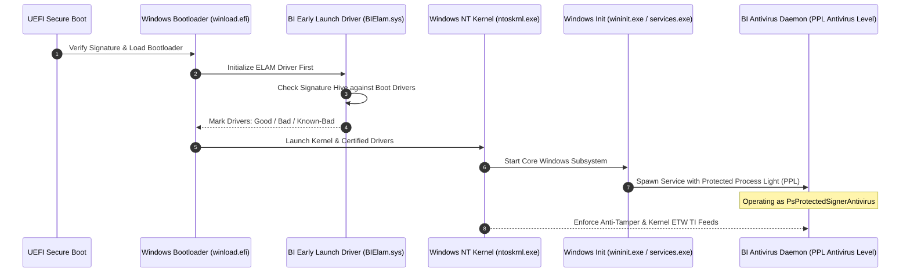

# BI Antivirus Enterprise — Engineering Specification: Early Launch Anti-Malware (ELAM) & Protected Process Light (PPL)
**Document ID:** SPEC-ELAM-PPL-002  
**Classification:** Enterprise Platform Security & Microsoft Certification  
**Target:** Kernel Boot-Time Integrity (`BIElam.sys`) & Tamper-Proof Service (`bi_antivirus_service.exe`)  
**Standard:** Microsoft Windows ELAM Specification, WHQL Hardware Compatibility, Authenticode Code Signing

---

## 1. Executive Summary

Enterprise endpoint security software is a primary target for sophisticated malware and advanced persistent threats (APTs). Without hardware-backed OS protection, administrative processes (even malware executing with elevated `NT AUTHORITY\SYSTEM` privileges) can terminate defensive daemons (`TerminateProcess`), unload kernel drivers, or modify registry keys.

To achieve authentic Bitdefender GravityZone parity, BI Antivirus must leverage two tightly coupled Microsoft security architectures:
1. **Early Launch Anti-Malware (ELAM):** A boot-start driver initialized by the Windows bootloader before any third-party drivers or services execute.
2. **Protected Process Light (PPL) Antivirus Level:** An OS kernel isolation boundary that prevents any non-protected process (including local SYSTEM and Administrator tokens) from injecting threads, opening handles with `PROCESS_ALL_ACCESS`, or reading virtual memory of the antivirus daemon.

---

## 2. Architecture & Boot-Time Sequence



---

## 3. Microsoft Certification & Code Signing Prerequisites

Protected Process Light (PPL) and ELAM cannot be activated with self-signed certificates or standard corporate code-signing certificates. Microsoft mandates an exhaustive legal and technical certification process:

### 3.1 Prerequisite Requirements Matrix
| Requirement | Description | Mandatory Authority |
| :--- | :--- | :--- |
| **EV Code Signing Certificate** | Extended Validation hardware-token certificate. | DigiCert / Sectigo / Entrust |
| **Microsoft Hardware Developer Account** | Verified organization dashboard with Azure AD Tenant. | Microsoft Partner Center |
| **WHQL Hardware Compatibility** | Passing Windows Hardware Lab Kit (HLK) test suites. | Microsoft Windows Hardware Lab |
| **ELAM Signing Attestation** | Microsoft cryptographically signs the ELAM driver binary. | Microsoft Corporation |
| **PPL Antivirus EKU** | Microsoft-issued Enhanced Key Usage (`1.3.6.1.4.1.311.61.4.1`). | Microsoft Security Partner Agreement |

> [!IMPORTANT]
> **Microsoft Access Boundary:** Protected Process Light (PPL) and ELAM certificates are not automatically obtainable, cannot be self-issued, and cannot be activated via standard administrative elevation. Access mandates an active commercial partnership contract with Microsoft Corporation (e.g. Microsoft Virus Initiative - MVI), thorough business vetting, and custom Authenticode EKU signatures issued directly by Microsoft. This architecture describes enterprise commercial requirements, not an active in-repo user-space feature.

---

## 4. ELAM Driver Architecture (`BIElam.sys`)

### 4.1 Driver Registration & INF Configuration
- **Start Type:** `SERVICE_BOOT_START` (0x00000000)
- **Group:** `Early-Launch`
- **Driver Entry Point:** `IoRegisterBootDriverCallback`

```c
NTSTATUS DriverEntry(PDRIVER_OBJECT DriverObject, PUNICODE_STRING RegistryPath) {
    BOOT_DRIVER_CALLBACK_REGISTRATION registration = {0};
    registration.Version = BOOT_DRIVER_CALLBACK_VERSION;
    registration.Callback = BIBootDriverCallback;
    
    return IoRegisterBootDriverCallback(&registration, &g_CallbackHandle);
}
```

### 4.2 Boot Driver Inspection Callback
The callback receives `BDCB_CALLBACK_TYPE` events as drivers are evaluated before initialization:
- `BdCbInitializeImage`: Boot driver image loaded into memory.
- `BdCbClassifyDrivers`: Classifies candidate boot drivers into one of four categories:
  - `BdCbClassificationGoodKnown` (Allowed to load)
  - `BdCbClassificationBadKnown` (Blocked immediately by bootloader)
  - `BdCbClassificationBadKnownCritical` (Blocked unless required for boot)
  - `BdCbClassificationUnknown` (Subject to enterprise policy)

### 4.3 ELAM Registry Hive
ELAM drivers utilize a dedicated minimal registry hive (`HKLM\ELAM\<DriverName>`) containing signed hashes of approved and blacklisted boot drivers. This hive is populated securely in user space and verified at boot.

---

## 5. Protected Process Light (PPL) Implementation

### 5.1 Protection Levels in Windows Kernel
Windows defines process protection hierarchy in the `EPROCESS` structure:
- `PsProtectedTypeNone` (Standard user processes)
- `PsProtectedTypeProtectedLight` (PPL)
- `PsProtectedTypeProtected` (Full Protected Process)

Under PPL, the signer type designates privileges. BI Antivirus targets:
- **Signer Type:** `PsProtectedSignerAntivirus` (0x07)

### 5.2 Enabling PPL for `bi_antivirus_service.exe`
To launch as a protected service:
1. **Service Binary Manifest:**
   The executable manifest must declare `protectedProcessType="antivirus"`.
2. **Authenticode Embedded Signature:**
   The binary must be signed with a certificate chaining to Microsoft Root CA containing the Antivirus PPL EKU:
   - `1.3.6.1.4.1.311.61.1.1` (ELAM / Early Launch)
   - `1.3.6.1.4.1.311.61.4.1` (Antivirus PPL Signer)
3. **Service Installation:**
   ```powershell
   sc.exe create BIAntivirus binPath= "D:\bit defender\bin\bi_service.exe" type= own start= auto
   sc.exe privs BIAntivirus SeChangeNotifyPrivilege/SeIncreaseQuotaPrivilege
   ```
4. **Kernel Access Rights Enforcement:**
   Once running as `PsProtectedSignerAntivirus`, the Windows kernel automatically strips dangerous access masks from non-protected callers:
   - `PROCESS_TERMINATE` (0x0001) -> Denied
   - `PROCESS_VM_WRITE` (0x0020) -> Denied
   - `PROCESS_VM_READ` (0x0010) -> Denied
   - `PROCESS_SUSPEND_RESUME` (0x0800) -> Denied

---

## 6. Accessing ETW Threat Intelligence (`Microsoft-Windows-Threat-Intelligence`)

A major capability gap in standard user-mode antivirus is inability to subscribe to the Microsoft Threat Intelligence ETW provider:
- **GUID:** `{F4E1897C-BB5D-5668-F1D8-040F4D8DD344}`
- **Security Constraint:** Microsoft restricts consumption of this kernel provider *exclusively* to processes running with `PsProtectedSignerAntivirus` protection.

### Telemetry Acquired via PPL Access:
1. **Direct Memory Injection Traces:** `EtwTiLogAllocExecVm` (detects `VirtualAllocEx` with `PAGE_EXECUTE_READWRITE`).
2. **Thread Manipulation:** `EtwTiLogSetContextThread` (detects thread hijacking).
3. **Process Hollowing:** `EtwTiLogMapViewOfSection` into remote processes.

---

## 7. Step-by-Step Production Roadmap


---

## 8. Risk Analysis & Mitigation

| Technical Risk | Impact | Mitigation Plan |
| :--- | :--- | :--- |
| **Boot Driver Loop (Boot-Looping OS)** | Disastrous | ELAM driver implements fail-safe watchdog timer; if signature check encounters corruption, defaults to `BdCbClassificationGoodKnown` to preserve OS bootability. |
| **Certificate Revocation by Microsoft** | Critical | Strict adherence to Microsoft Antivirus Vendor Code of Conduct; rigorous pre-release security audits of all update pipelines. |
| **PPL Debugging Obstacle** | High | Kernel debugging on test rigs requires `/DEBUG` boot flag and custom certificate bypasses during development. |

---

## 9. Engineering Dependencies, Specialist Skills & Validation Effort

- **Organizational Prerequisite:** Formally registered commercial legal entity in good standing, corporate EV hardware certificate, verified Microsoft Partner Center account.
- **Specialist Capabilities Required:** Windows Kernel Driver Developer (C / WDK), Security Certification Engineer, HLK automated test operator.
- **Infrastructure Dependencies:** Hardware Lab Kit (HLK) server + client testbed running Windows 10/11 & Server targets; dedicated secure hardware security module (HSM) for key custody.
- **Scope Distinction:** ELAM and PPL operate at Ring 0 and early boot loader layers. The current BI Antivirus repository operates strictly in sovereign Windows user space. Kernel drivers and PPL isolation require the above Microsoft certifications before production binary compilation.
