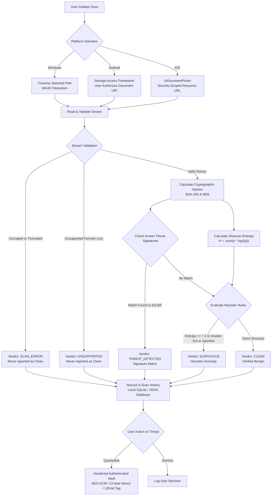

# BI ANTIVIRUS ENTERPRISE — CROSS-PLATFORM ARCHITECTURE SPECIFICATION

**Document Version:** 1.0.0  
**Date:** November 14, 2026  
**Platforms Supported:**  
1. **Windows 10 / 11 (x64)** &mdash; Native Python 3.12 / Win32 Architecture  
2. **Android 10+ (API 29 - 35)** &mdash; Native Kotlin / Jetpack Compose Architecture  
3. **iOS 16+ (iPhone / iPad)** &mdash; Native Swift 5 / SwiftUI Architecture  

---

## 1. Architectural Philosophy

BI Antivirus Enterprise delivers a coherent, multi-platform endpoint defense platform. Rather than attempting a fragile, lowest-common-denominator cross-platform framework (such as React Native or Flutter) that struggles to interface cleanly with native OS security APIs, BI Antivirus employs a **Sovereign Native Architecture**:

1. **Native Implementation per OS:** Each platform utilizes its recommended first-party language, runtime, and UI framework:
   - **Windows:** Python 3.12 with Win32 `ctypes` and native Tkinter desktop dashboard.
   - **Android:** Kotlin with AndroidX, Jetpack Compose, Coroutines, and the Storage Access Framework (SAF).
   - **iOS:** Swift 5 with SwiftUI, CryptoKit, and the Document Picker framework.
2. **Shared Security Models & Schemas:** Threat definition catalogs, hash standards, Shannon entropy thresholds, MITRE ATT&CK taxonomies, and scan event models are standardized in canonical JSON schemas in `shared/`.
3. **Platform Boundary Compliance:** Each application strictly respects OS sandboxing, permission models, and user privacy:
   - Windows respects user privilege levels and never bypasses OS security controls.
   - Android operates strictly within Scoped Storage and SAF without requiring root.
   - iOS operates strictly within Apple's App Sandbox without attempting private API exploitation or jailbreak dependencies.
4. **Unified Visual Language:** All three applications share the **Cyber Dark & Regal Gold** visual identity, consistent naming conventions, and intuitive risk state indicators.

---

## 2. Directory Layout & Repository Structure

```
D:\bit defender\
│
├── bi_antivirus\                  # [WINDOWS] Native Python 3.12 & Win32 Platform
│   ├── core\                      # Detection, Scanner, Quarantine, EDR, ML, Policy
│   ├── monitors\                  # Realtime, Exploit Shield, USB, Firewall, Encryption
│   ├── ui\                        # Tkinter Cyber Dark Desktop Dashboard (13 views)
│   └── tests\                     # 44 Test Suites (276 unit tests)
│
├── android\                       # [ANDROID] Native Kotlin Application (Android Studio)
│   ├── app\
│   │   ├── src\
│   │   │   ├── main\
│   │   │   │   ├── java\com\biantivirus\security\
│   │   │   │   │   ├── core\      # Scanner, HashEngine, HeuristicEngine, QuarantineManager
│   │   │   │   │   ├── model\     # ThreatSignature, ScanResult, SecurityReport
│   │   │   │   │   ├── posture\   # DevicePostureAuditor (Lock, Encryption, USB Debugging)
│   │   │   │   │   ├── storage\   # ScanHistoryRepository, SafeStorageHelper
│   │   │   │   │   └── ui\        # Jetpack Compose Screens & Cyber Dark/Gold Theme
│   │   │   │   ├── res\           # Vector drawables, strings, layouts
│   │   │   │   └── AndroidManifest.xml
│   │   │   └── test\              # Kotlin / JUnit 4 Unit Tests
│   │   ├── build.gradle.kts
│   │   └── proguard-rules.pro
│   ├── build.gradle.kts
│   ├── settings.gradle.kts
│   └── gradlew.bat
│
├── ios\                           # [iOS] Native Swift & SwiftUI Application (Xcode)
│   ├── BIAntivirus\
│   │   ├── App\                   # BIAntivirusApp.swift entry point
│   │   ├── Core\                  # ScannerEngine, HashCalculator, EntropyAnalyzer, ThreatCatalog
│   │   ├── Models\                # ScanItem, ThreatRecord, DeviceSecurityPosture
│   │   ├── Posture\               # iOSDevicePostureChecker (Passcode, Biometrics, OS Updates)
│   │   ├── Storage\               # ScanHistoryStore, IsolatedVaultManager
│   │   ├── Views\                 # SwiftUI Screens (Dashboard, FileScan, Posture, History, Settings)
│   │   ├── Theme\                 # CyberDarkGoldTheme (SwiftUI Color Tokens)
│   │   └── Info.plist
│   ├── BIAntivirus.xcodeproj\     # Xcode Project Package Definition
│   └── BIAntivirusTests\          # XCTest Unit Tests for Scanning, Hash, Posture
│
├── shared\                        # [SHARED] Cross-Platform Assets & Schemas
│   ├── signatures\
│   │   ├── mobile_threat_signatures.json   # Known mobile malicious hashes & patterns
│   │   └── desktop_threat_signatures.json  # Desktop PE & script signatures
│   ├── schemas\
│   │   ├── scan_result.schema.json         # Standardized scan result telemetry schema
│   │   └── posture_report.schema.json      # Standardized device posture schema
│   └── test_vectors\                       # Harmless synthetic test files (EICAR, test tokens)
│
├── docs\                          # Technical Specifications & Guides
├── submission\                    # Audit Reports, Parity Matrices & Handover Artifacts
└── scripts\                       # Build, test, and acceptance validation harnesses
```

---

## 3. Subsystem Cross-Platform Matrix

| Subsystem | Windows 10/11 x64 | Android (Kotlin) | iOS (Swift) |
| :--- | :--- | :--- | :--- |
| **Language & Framework** | Python 3.12 / Win32 ctypes | Kotlin 1.9+ / AndroidX | Swift 5.9+ / SwiftUI |
| **UI Architecture** | Tkinter Cyber Dark (13 views) | Jetpack Compose Cyber Dark & Gold | SwiftUI Cyber Dark & Gold |
| **File Scanning Mechanism** | Direct Win32 filesystem traversal (`os.scandir`) | Storage Access Framework (SAF) URI stream reading | `UIDocumentPicker` / `.fileImporter` security-scoped URLs |
| **Integrity Calculation** | Python `hashlib.sha256()` streaming | Java `MessageDigest.getInstance("SHA-256")` | Apple `CryptoKit.SHA256.hash(data:)` |
| **Heuristic Analysis** | Double extensions, PE headers, Shannon entropy ($H \ge 7.2$) | Double extensions, APK manifest anomalies, Shannon entropy | Double extensions, Mach-O inspection, Shannon entropy |
| **Threat Signature DB** | SQLite WAL database (`signatures.db`) | Local SQLite / Bundled JSON Signature Catalog | Bundled JSON Threat Catalog / CoreData store |
| **Quarantine Storage** | AES-256-CBC with HMAC-SHA256 Encrypt-then-MAC vault | AES-256-GCM authenticated vault (`context.filesDir/quarantine`, 12B nonce, 128b tag) | Apple CryptoKit AES.GCM sealed vault (`QuarantineVault`, 12B nonce, 128b tag) |
| **Device Posture Auditing** | UAC, Windows Defender, BitLocker, Firewall, SMBv1 | Lock Screen, Biometrics, Device Encryption, ADB, Unknown Sources | Passcode active, Face ID/Touch ID, iOS version, Wi-Fi hygiene |
| **Persistence / Autostart** | Optional Windows Service / Registry Run key | Optional WorkManager periodic worker | Not permitted by iOS; user-launched |

---

## 4. Threat Detection & Scanning Workflow



---

## 5. Security & Privacy Guarantees

1. **User Authorization First:** On both Android and iOS, all file inspection is explicitly initiated and authorized by the user via system file picker sheets. Zero background unauthorized snooping.
2. **Zero Cloud Telemetry Leakage:** All hash checking, entropy calculation, and signature matching occur **100% locally on-device**. No user files, hashes, or filenames are transmitted to remote servers.
3. **No Root / Jailbreak Requirement:** Both mobile applications run cleanly on standard, consumer-stock operating systems. They do not request or rely on Superuser, Root, or Jailbreak exploits.
4. **Data Sovereignty:** Quarantine vaults are encrypted locally using platform-native cryptographic primitives (Android Keystore / iOS Keychain & CryptoKit).

---

## 6. Shared Visual Identity & Design Language

All platforms implement the unified **BI Antivirus Theme**:

```json
{
  "theme": "Cyber Dark & Gold",
  "colors": {
    "background_deep": "#090D12",
    "surface_card": "#141E2E",
    "surface_card_hover": "#1C2A3F",
    "border_subtle": "#21324A",
    "accent_gold": "#E5A93B",
    "accent_gold_bright": "#F4C465",
    "status_safe_emerald": "#00D285",
    "status_warning_amber": "#FFB020",
    "status_danger_crimson": "#FF385C",
    "text_primary": "#F0F4F8",
    "text_secondary": "#94A3B8"
  }
}
```

This ensures an immediate, professional brand recognition across Windows desktop, Android phones/tablets, and iPhone/iPad devices.
