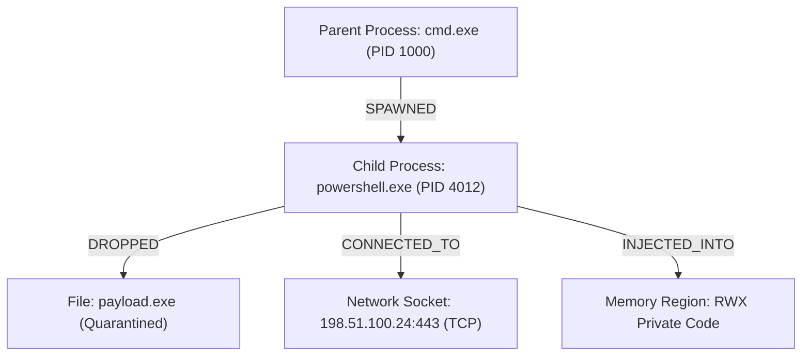

# BI ANTIVIRUS — TECHNICAL SPECIFICATION
## ENTERPRISE EDR INCIDENT GRAPH & MITRE ATT&CK CORRELATION ENGINE

**Module:** `bi_antivirus.core.incident_graph`  
**Architecture:** Multi-Vector In-Memory Graph & Relational SQLite Persistence  
**Security Classification:** Enterprise Detection and Response (EDR)  
**Author:** BI Antivirus Development Team  

---

## 1. PURPOSE & VISION

In modern enterprise threat landscapes, attacks rarely manifest as isolated file detections. Sophisticated adversaries execute multi-stage kill chains involving living-off-the-land binaries (LOLBins), script interpreters (PowerShell), in-memory shellcode injection, removable media staging, and outbound command-and-control (C2) communication.

The BI Antivirus EDR Incident Graph Engine unifies telemetry from across the entire protection platform into an interconnected, directional entity graph. It synthesizes disparate alerts into single cohesive security incidents, establishes parent-child causality, maps observable telemetry directly to the **MITRE ATT&CK Enterprise Matrix**, and generates forensic exports for security operations center (SOC) analysts.

---

## 2. GRAPH DATA MODEL

The incident graph is constructed from strongly typed entities and directional relationships:

### 2.1 IncidentNode
Represents an entity participating in an incident:
- `node_id`: Canonical identifier string (`proc:<PID>`, `file:<PATH>`, `net:<IP>:<PORT>`, `dev:<DRIVE>`, `quar:<VAULT_ID>`).
- `node_type`: Category (`PROCESS`, `FILE`, `NETWORK`, `DEVICE`, `MEMORY`, `POLICY`).
- `label`: Human-readable display label (e.g. `powershell.exe (PID: 4012)`).
- `properties`: Subsystem-specific key-value metadata (command-line arguments, SHA-256 hash, file size, IP protocol, etc.).
- `timestamp`: Epoch creation time.

### 2.2 IncidentEdge
Represents a directional relationship between two nodes:
- `source_id`: Source node identifier.
- `target_id`: Target node identifier.
- `relation`: Directional relationship verb:
  - `SPAWNED`: Parent process creates a child process.
  - `DROPPED`: Process writes an executable file to disk.
  - `ACCESSED`: Process reads or executes a target file.
  - `QUARANTINED`: Threat detector moves file into encrypted quarantine vault.
  - `CONNECTED_TO`: Process establishes an outbound network socket.
  - `BLOCKED`: Application Control or Device Control denies an operation.
  - `INJECTED_INTO`: Exploit Shield identifies memory code injection.
  - `MOUNTED`: Removable storage device attached to the host.
- `metadata`: Contextual evidence (e.g., arguments passed, duration, firewall rule).

### 2.3 Chronological Timeline
Maintains a granular, millisecond-ordered log of every atomic telemetry event associated with the incident, allowing analysts to reconstruct the exact attacker sequence of operations.

---

## 3. MULTI-VECTOR CORRELATION LOGIC

When a security event occurs in any subsystem, it is ingested via `IncidentGraphEngine.ingest_event(event_type, data)`. The correlation engine evaluates the event against existing active incidents using candidate indexing keys:
1. `proc:<PID>` (Target Process ID)
2. `proc:<PPID>` (Parent Process ID)
3. `file:<NORMALIZED_PATH>` (Target File Path)
4. `dev:<DRIVE_LETTER>` (Removable Drive Letter)

If any candidate key matches an active incident, the new event, nodes, and edges are merged into that existing incident. If no match exists, a new correlated incident is initialized with a unique identifier (`INC-YYYYMMDD-<RAND6>`).

---

## 4. MITRE ATT&CK ENTERPRISE MATRIX MAPPING

Techniques are mapped strictly when concrete, verifiable telemetry evidence is observed:

| Technique ID | Technique Name | Tactic | Concrete Observable Trigger Evidence |
|---|---|---|---|
| **T1059.001** | Command and Scripting Interpreter: PowerShell | Execution | Execution of `powershell.exe` with `-enc`, `-encodedcommand`, `downloadstring`, `iex`, or `-w hidden` flags. |
| **T1059.003** | Command and Scripting Interpreter: Windows Command Shell | Execution | Execution of `cmd.exe /c` or batch script execution spawning child utilities. |
| **T1055** | Process Injection | Defense Evasion / Privilege Escalation | Exploit Shield detects RWX unbacked executable memory or private code injection in a non-JIT native process. |
| **T1486** | Data Encrypted for Impact | Impact | Ransomware Shield intercepts high-frequency file mutations, decoy canary modifications, or extortion note drops. |
| **T1091** | Replication Through Removable Media | Lateral Movement / Initial Access | USB Sentinel detects `autorun.inf` worms or suspicious `.lnk` shortcut storms on removable media. |
| **T1218** | System Binary Proxy Execution (LOLBins) | Defense Evasion | Invocation of trusted Windows system binaries (`certutil.exe`, `mshta.exe`, `rundll32.exe`, `regsvr32.exe`, `wmic.exe`) with command-line arguments. |
| **T1071.001** | Application Layer Protocol: Web Protocols | Command and Control | Outbound TCP socket to port 80, 443, 8080, or 8443 established by a flagged process or non-browser binary. |
| **T1490** | Inhibit System Recovery | Impact | Process attempts deletion of Volume Shadow Copies (`vssadmin delete shadows`, `wmic shadowcopy delete`, or `bcdedit /set recoveryenabled No`). |
| **T1204.002** | User Execution: Malicious File | Execution | User attempts execution of a blacklisted binary blocked by Application Control or flagged by Threat Detector. |

---

## 5. SEVERITY & CONFIDENCE SCORING FORMULA

### 5.1 Correlation Confidence Calculation
Confidence reflects the number of independent corroborating telemetry sources validating the attack chain:
$$\text{Confidence} = \min\left(0.50 + 0.15 \times N_{\text{types}} + 0.05 \times N_{\text{sources}},\, 0.99\right)$$
- $N_{\text{types}}$: Number of distinct node types involved (e.g. Process + File + Network = 3 types $\to +0.45$).
- $N_{\text{sources}}$: Number of distinct sensor subsystems reporting (e.g. RealTimeGuard + ExploitShield + FirewallMonitor $\to +0.15$).
- Maximum confidence: **99%**.

### 5.2 Severity Tiering
- **CRITICAL:** Triggered if any high-impact technique is detected:
  - `T1486` (Ransomware encryption activity)
  - `T1055` (Process injection / memory exploitation)
  - `T1490` (Shadow copy / recovery inhibition)
  - Application Control block in enforce mode.
- **HIGH:** Triggered if suspicious execution techniques are detected:
  - `T1059.001` (Encoded PowerShell)
  - `T1218` (LOLBin abuse)
  - `T1091` (Removable media worm)
- **MEDIUM:** 3 or more correlated entities or 4 or more timeline events without critical techniques.
- **LOW:** Isolated informational or baseline audit events.

---

## 6. FORENSIC EXPORT CAPABILITIES

### 6.1 Markdown Investigation Report (`export_incident_markdown`)
Generates complete SOC documentation containing:
1. Incident Metadata (ID, Title, Severity, Confidence %, Root Entity, Timestamps).
2. Executive Summary.
3. MITRE ATT&CK Matrix Alignment Table with observable evidence.
4. Chronological Forensic Timeline Table.
5. Entity Graph & Relationship Tree.
6. Recommended Remediation & Containment Actions (Host Isolation, Process Kill, Quarantine Verification, Policy Hardening).

### 6.2 Canonical JSON Export (`export_incident_json`)
Exports structured JSON conforming to enterprise SIEM schema standards for direct ingestion into Splunk, Elastic, Microsoft Sentinel, or Google Chronicle.
