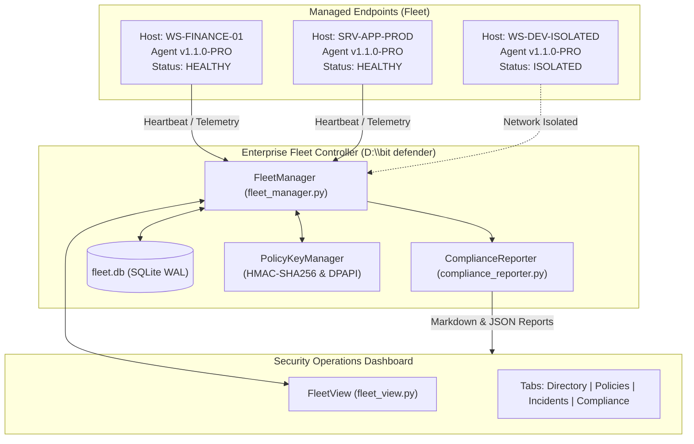

# BI Antivirus — Enterprise Fleet Management Architecture

**Platform:** BI Antivirus — Cyber Defense Platform  
**Subsystem:** Enterprise Fleet Management & Centralized Policy Enforcement  
**Parity Target:** Bitdefender GravityZone Business Security & Enterprise Posture  
**Release:** Sprint 4 Production Hardening  

---

## 1. Subsystem Overview

The Enterprise Fleet Management subsystem transforms BI Antivirus from a standalone endpoint defense tool into a distributed, local-first enterprise endpoint management platform. Designed with clean-room architecture inspired by Bitdefender GravityZone Business Security, it provides centralized endpoint registration, continuous heartbeat monitoring, monotonic policy distribution with anti-rollback protection, automated EDR incident aggregation, and cryptographic administrator audit trails.

---

## 2. Core Data Models (`fleet_models.py`)

All enterprise models are implemented as typed Python dataclasses with native JSON serialization (`to_dict()`) and deserialization (`from_dict()`):

### 2.1 `EndpointDevice`
Represents an enrolled workstation, server, or cloud host.
- `id` (`str`): Unique endpoint identifier (e.g., `EP-A1B2C3D4E5F6`).
- `hostname` (`str`): Network host name.
- `ip_address` (`str`): Primary IPv4/IPv6 address.
- `os_version` (`str`): Operating system and build number.
- `agent_version` (`str`): BI Antivirus client version.
- `last_seen` (`float`): Epoch timestamp of last successful heartbeat.
- `health_status` (`str`): `HEALTHY`, `AT_RISK`, or `OFFLINE`.
- `assigned_policy_id` (`str`): Active policy identifier (default `POL-DEFAULT-V1`).
- `tags` (`List[str]`): Administrative tags for categorization and search.
- `isolation_status` (`bool`): Boolean flag indicating host containment state.
- `department` (`str`): Departmental grouping (e.g., Finance, Engineering).
- `registered_at` (`float`): Timestamp of initial enrollment.
- `enrollment_token` (`str`): Truncated SHA-256 fingerprint of enrollment token.

### 2.2 `FleetPolicy`
Monotonically versioned enterprise configuration bundle.
- `policy_id` (`str`): Unique policy identifier.
- `policy_name` (`str`): Human-readable policy title.
- `version` (`int`): Monotonically increasing sequence integer.
- `rules` (`Dict[str, Any]`): Security rule parameters (Real-Time Scan, USB Sentinel, Ransomware Shield, Exploit Shield, Firewall, EDR telemetry).
- `created_at` / `updated_at` (`float`): Timestamps of policy evolution.
- `description` (`str`): Operational purpose and documentation.

### 2.3 `FleetEvent`
Individual telemetry alerts and state changes emitted by endpoints.
- `event_id` (`str`): Telemetry event identifier (`EVT-...`).
- `endpoint_id` (`str`): Source endpoint ID.
- `event_type` (`str`): Classification (`ENDPOINT_REGISTERED`, `THREAT_DETECTED`, `RANSOMWARE_BURST`, `POLICY_APPLIED`, `HEARTBEAT`).
- `severity` (`str`): `CRITICAL`, `HIGH`, `MEDIUM`, `LOW`, `INFO`.
- `payload` (`Dict[str, Any]`): Detailed threat or operational metrics.
- `timestamp` (`float`): Event occurrence time.

### 2.4 `FleetIncident`
Centralized security incident aggregating multiple correlated events or high-severity threat detections.
- `incident_id` (`str`): Incident identifier (`INC-...`).
- `severity` (`str`): `CRITICAL`, `HIGH`, `MEDIUM`, `LOW`.
- `title` (`str`): Descriptive incident title.
- `affected_endpoints` (`List[str]`): List of impacted endpoint device IDs.
- `root_cause` (`str`): Initial trigger description.
- `status` (`str`): `ACTIVE`, `INVESTIGATING`, `CONTAINED`, `RESOLVED`.
- `timeline` (`List[Dict[str, Any]]`): Chronological response actions.

### 2.5 `AdminAuditEntry`
Cryptographically traceable administrator action record.
- `audit_id` (`str`): Audit log record ID (`AUD-...`).
- `admin_id` (`str`): Operator identifier.
- `action` (`str`): Action performed (`POLICY_UPDATED`, `ENDPOINT_ISOLATED`, `POLICY_ASSIGNED`).
- `target_type` / `target_id` (`str`): Target resource category and ID.
- `timestamp` (`float`): Audit time.
- `details` (`Dict[str, Any]`): Parameter details.
- `auth_token_hash` (`str`): SHA-256 authorization token fingerprint.

---

## 3. Database Schema (`fleet.db`)

Fleet state is persisted in a thread-safe SQLite database at `D:\bit defender\data\fleet.db` using WAL journal mode:

| Table | Primary Key | Key Columns | Purpose |
|---|---|---|---|
| `fleet_endpoints` | `id` | `hostname`, `ip_address`, `health_status`, `isolation_status`, `assigned_policy_id` | Managed endpoint inventory |
| `fleet_policies` | `policy_id` | `policy_name`, `version`, `rules` (JSON) | Monotonic security policies |
| `fleet_events` | `event_id` | `endpoint_id`, `event_type`, `severity`, `payload` | Telemetry event log |
| `fleet_incidents` | `incident_id` | `title`, `severity`, `affected_endpoints`, `status` | EDR incident tracker |
| `fleet_audit_log` | `audit_id` | `admin_id`, `action`, `target_type`, `target_id`, `auth_token_hash` | Immutable admin audit trail |

Indices are maintained on `fleet_endpoints(health_status)`, `fleet_events(endpoint_id)`, `fleet_events(timestamp)`, `fleet_incidents(status)`, and `fleet_audit_log(timestamp)`.

---

## 4. Key Mechanisms & Defenses

### 4.1 Monotonic Policy Sequence & Rollback Protection
To prevent rollback attacks where an adversary or compromised node attempts to re-apply an older, weaker security policy:
$$\text{Update Allowed} \iff \text{version}_{\text{new}} > \text{version}_{\text{current}}$$
If an update attempt specifies $\text{version}_{\text{new}} \le \text{version}_{\text{current}}$, `FleetManager.create_or_update_policy()` strictly rejects the operation, logs a warning, and records an administrative audit entry.

### 4.2 Offline Endpoint Detection
Endpoints report health status periodically. The background fleet sweeper (`sweep_offline_endpoints()`) checks `last_seen`:
$$\text{Condition: } (t_{\text{now}} - t_{\text{last\_seen}}) > 300\text{ s} \implies \text{health\_status} \leftarrow \text{OFFLINE}$$
When an endpoint sends a subsequent heartbeat, its health is automatically restored to `HEALTHY`.

### 4.3 Endpoint Containment (Network Isolation)
When an endpoint exhibits critical malware activity or ransomware burst mutations, the administrator can issue an isolation order from the UI or API (`isolate_endpoint()`). This marks `isolation_status = True` and sets `health_status = AT_RISK`, instructing the agent to drop non-management traffic until an authorized `unisolate_endpoint()` command is verified.

---

## 5. GravityZone Feature Parity Matrix

| Feature | Bitdefender GravityZone | BI Antivirus Sprint 4 | Parity Assessment |
|---|---|---|---|
| Centralized Endpoint Inventory | Web Console | Desktop GUI & Local Database (`fleet.db`) | Functional parity for local-first operations |
| Policy Management | Hierarchical Cloud Policy | Monotonic Sequence Policies with Rollback Protection | Architectural parity |
| Endpoint Isolation / Containment | Single-click Host Isolation | Host Isolation Toggle with Admin Audit Logging | Functional parity |
| EDR Incident Correlation | Incident Advisor Graph | Incident Aggregator + Incident Graph Engine | Clean-room heuristic parity |
| Compliance & Executive Reporting | Scheduled PDF / Email Reports | Markdown & JSON Compliance Reporter | Export parity with legal disclaimers |
| Cryptographic Integrity | Cloud Certificates | HMAC-SHA256 + Windows DPAPI Machine Key | Verified local equivalent |
