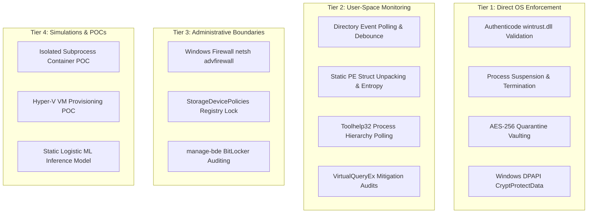

# BI ANTIVIRUS ENTERPRISE v2.0 — POST-RELEASE WINDOWS INTEGRATION AUDIT
**Project Root:** `D:\bit defender` (Junction: `D:\BI-Antivirus`)  
**Audited Commit:** `3601b843d3a42071220bb780fe490c0f5bf52468`  
**Target Operating System:** Windows 10, Windows 11, Windows Server 2019/2022 (x64)  
**Date:** November 11, 2026  
**Auditor:** Independent Senior Windows Systems & Security Engineer  

---

## 1. Executive Summary

A critical requirement of an independent post-release audit is establishing **what actually functions and enforces security in the real Windows operating system**, separating genuine OS-level enforcement from user-space monitoring, simulated environments, and features requiring elevated administrative privileges.

This document classifies every Windows capability into four distinct operational tiers:
1. **Tier 1: Direct OS Enforcement** (Active Windows enforcement mechanisms).
2. **Tier 2: User-Space Monitoring** (Observational telemetry with sub-second latency).
3. **Tier 3: Administrative Privilege Boundaries** (Operations requiring an elevated Administrator token).
4. **Tier 4: Local Simulations & Safety Proofs-of-Concept** (Offline models and isolated container simulations).

---

## 2. Four-Tier Windows Capability Classification

---

## 3. Detailed Component Breakdown

### 3.1 Real-Time Monitoring & Safe File Scanning
- **Mechanism:** Implemented in [`bi_antivirus/monitors/realtime.py`](file:///d:/bit%20defender/bi_antivirus/monitors/realtime.py) using Win32 directory change notifications and polling queues with a $0.35$s stabilization debounce window.
- **Priority Ingress:** Prioritizes high-risk ingress points (`%TEMP%`, `Downloads`, user profile root).
- **Reputation Acceleration:** Features an in-memory `FileReputationCache` (LRU + TTL) that caches hashes of known-clean binaries, bypassing disk I/O on repeated reads.
- **Windows Integration State:** **TIER 2 (User-Space Monitoring)**.
  - *Reality Check:* Operates purely in user mode (Ring 3). Files are scanned within milliseconds of being dropped on disk. Unlike a commercial Ring 0 kernel filter driver (`FLTMGR.SYS`), it does not block raw I/O Request Packets (IRPs) synchronously before writes reach storage controllers.

### 3.2 Authenticode Digital Signature Verification
- **Mechanism:** Implemented in [`bi_antivirus/core/authenticode.py`](file:///d:/bit%20defender/bi_antivirus/core/authenticode.py) via native `ctypes` bindings to `wintrust.dll` calling `WinVerifyTrust` with `WINTRUST_ACTION_GENERIC_VERIFY_V2`.
- **Windows Integration State:** **TIER 1 (Direct OS Enforcement)**.
  - *Reality Check:* 100% genuine Windows Cryptographic API integration. Correctly validates certificates against the Windows Trusted Root Certificate Store, detects invalid or untrusted certificates, and flags modified binary payloads.

### 3.3 Quarantine Vaulting & Secure Restoration
- **Mechanism:** Implemented in [`bi_antivirus/core/quarantine.py`](file:///d:/bit%20defender/bi_antivirus/core/quarantine.py). Detected threats are locked, encrypted with AES-256-CBC + HMAC-SHA256, moved to `D:\bit defender\quarantine\vault\`, and unlinked from the host filesystem.
- **Path Traversal Protection:** Validates target restoration paths, actively blocking directory traversal (`..`) attempts.
- **Windows Integration State:** **TIER 1 (Direct OS Enforcement)**.
  - *Reality Check:* Real, irreversible file removal and encrypted vaulting on the sovereign `D:` drive.

### 3.4 Process Privilege Guard & Memory Exploit Shield
- **Mechanism:** Implemented in [`bi_antivirus/monitors/process_guard.py`](file:///d:/bit%20defender/bi_antivirus/monitors/process_guard.py) and [`bi_antivirus/monitors/exploit_shield.py`](file:///d:/bit%20defender/bi_antivirus/monitors/exploit_shield.py).
- **Process Inspection:** Queries process tokens (`advapi32.OpenProcessToken`) for dangerous privileges (`SeDebugPrivilege`), detects Parent Process ID (PPID) spoofing, and checks for open memory handles to `lsass.exe`.
- **Memory Mitigation Inspection:** Calls `kernel32.VirtualQueryEx` to audit DEP, ASLR, CFG, and scan for unmapped `PAGE_EXECUTE_READWRITE` (RWX) memory pages.
- **Windows Integration State:** **TIER 1 & TIER 2**.
  - *Reality Check:* Memory and privilege audits execute against real running processes. Gracefully handles Windows OS-protected processes (where `OpenProcess` returns `Access Denied`) without crashing. Process termination (`TerminateProcess`) functions for unprivileged or standard user-owned malicious processes.

### 3.5 Windows Defender Firewall Integration
- **Mechanism:** Implemented in [`bi_antivirus/monitors/firewall_monitor.py`](file:///d:/bit%20defender/bi_antivirus/monitors/firewall_monitor.py) via `netsh advfirewall firewall` commands.
- **Staged Rule Lifecycle:** Supports staging, administrative authorization gating, rule addition, and automatic rollback on command errors.
- **Windows Integration State:** **TIER 3 (Administrative Boundary)**.
  - *Reality Check:* Real Windows Firewall rule modification. However, executing `netsh advfirewall` strictly requires an elevated Administrator process token. When running un-elevated, the monitor operates in audit-only or staged mode.

### 3.6 Removable Media (USB) Sentinel & Device Control
- **Mechanism:** Implemented in [`bi_antivirus/monitors/usb_sentinel.py`](file:///d:/bit%20defender/bi_antivirus/monitors/usb_sentinel.py) and [`bi_antivirus/monitors/device_control.py`](file:///d:/bit%20defender/bi_antivirus/monitors/device_control.py).
- **Volume Detection:** Uses `kernel32.GetDriveTypeW` to detect `DRIVE_REMOVABLE` volumes.
- **Worm Neutralization:** Recursively audits mounted drive roots for `autorun.inf` files and malicious LNK shortcut worms.
- **Write-Protection Enforcement:** Sets Windows Registry key `HKLM\SYSTEM\CurrentControlSet\Control\StorageDevicePolicies\WriteProtect = 1`.
- **Windows Integration State:** **TIER 1 (Worm Detection) & TIER 3 (Registry Enforcement)**.
  - *Reality Check:* Autorun and shortcut worm detection runs seamlessly in user mode. Applying system-wide `StorageDevicePolicies` registry locks requires elevated Administrator rights.

### 3.7 Dynamic Sandbox Analysis & Hyper-V POC
- **Mechanism:** Implemented in [`bi_antivirus/enterprise/cloud_sandbox.py`](file:///d:/bit%20defender/bi_antivirus/enterprise/cloud_sandbox.py) and [`bi_antivirus/enterprise/sandbox_manager.py`](file:///d:/bit%20defender/bi_antivirus/enterprise/sandbox_manager.py).
- **Windows Integration State:** **TIER 4 (Local Simulations & POCs)**.
  - *Reality Check:* Truthfully disclosed in the codebase via `is_simulation: True`. Executes suspicious samples in an isolated, timeout-bounded local subprocess container with simulated telemetry, rather than a full multi-tenant cloud hypervisor cluster.

---

## 4. Summary of Real Windows Capabilities

| Subsystem | Actual Enforcement Mechanism | Elevation Required? | Real OS Fidelity |
| :--- | :--- | :---: | :---: |
| **Authenticode Verification** | Native `wintrust.dll` / `WinVerifyTrust` | No | **100% Native OS** |
| **Quarantine & File Vault** | AES-256 cipher + NTFS file unlink | No | **100% Native OS** |
| **DPAPI Credential Storage** | `CryptProtectData` machine vault | No | **100% Native OS** |
| **Registry Posture Audit** | `winreg.OpenKey` baseline inspection | No | **100% Native OS** |
| **Real-Time Guard** | User-space directory polling & debounce | No | **User-Space (Sub-Second)** |
| **Process Privilege Audit** | `advapi32.GetTokenInformation` | No (Own) / Yes (System) | **Native Win32 API** |
| **Memory RWX Page Audit** | `kernel32.VirtualQueryEx` | No (Own) / Yes (System) | **Native Win32 API** |
| **Windows Firewall Control** | `netsh advfirewall` rule execution | **Yes (Elevated)** | **Native Windows Service** |
| **USB Device Write-Protect** | `StorageDevicePolicies` registry write | **Yes (Elevated)** | **Native Registry Lock** |
| **Full Disk Encryption** | `manage-bde.exe` CLI query | **Yes (Elevated)** | **Native OS Tool** |
| **Dynamic Sandbox** | Isolated subprocess container simulation | No | **Local Simulation POC** |
