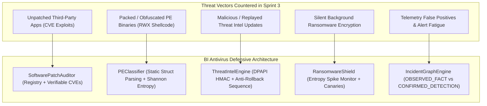

# BI Antivirus — Sprint 3 Security Findings & Threat Model
**Document Version:** 1.0.0  
**Project:** BI Antivirus — Enterprise Defense Platform  
**Target Environment:** Windows 10/11 Enterprise / Server (Canonical Storage: `D:\bit defender`, Junction: `D:\BI-Antivirus`)  
**Publication Repository:** `https://github.com/jitendersainik2006-ops/BI-Antivirus`  
**Classification:** Enterprise Security Audit & Defense Verification  

---

## 1. Threat Modeling & Adversary Vectors Addressed

Sprint 3 implements defensive security controls engineered to counter prominent endpoint attack vectors identified in recent threat intelligence reports and the MITRE ATT&CK enterprise matrix:

---

## 2. In-Depth Analysis of Defensive Modules

### 2.1 Local PE Static Binary Classifier
- **Adversary Technique:** Modern malware authors obfuscate executables using custom crypters, packers (e.g., UPX, Themida, VMProtect), or unbacked RWX memory sections to evade basic hash checks and signature matching.
- **Defensive Mechanism:**
  - Struct unpacking parses the DOS, COFF, and Optional headers without executing untrusted code or invoking shell utilities.
  - Section permission auditing flags `IMAGE_SCN_MEM_EXECUTE | IMAGE_SCN_MEM_WRITE` (0xE0000000) as a high-risk anomaly (+35 score).
  - Mathematical Shannon entropy calculation ($H \ge 7.0$ bits/byte) identifies compressed or encrypted payloads.
  - Import Address Table (IAT) scanning checks for dual-use injection APIs (`VirtualAlloc`, `WriteProcessMemory`, `CreateRemoteThread`).
- **Anti-Hallucination & Explainability Guarantee:**
  - Unlike opaque "black-box" machine learning claims that provide non-verifiable percentage scores, the PE classifier relies on deterministic, mathematically verifiable heuristics with explainable audit trails (e.g., *"+35: CRITICAL ANOMALY: Detected 1 RWX section(s): .rwxsec"*).

### 2.2 Software Inventory & Patch Auditor
- **Adversary Technique:** Threat actors weaponize known public vulnerabilities (e.g., 7-Zip heap buffer overflows, WinRAR directory traversal, Chrome V8 escapes) to achieve initial execution or privilege escalation before organizations apply vendor patches.
- **Defensive Mechanism:**
  - Automated read-only enumeration of Windows Uninstall registry hives captures all installed applications across 64-bit, 32-bit (WOW64), and user profiles.
  - Semantic versioning normalization ensures accurate comparison without false positive matches on minor revision tags.
  - Matches installed versions against local verifiable CVE records with fixed version baselines.
- **Zero-Silent-Modifications Policy:**
  - Critical security principle: Antivirus software must not secretly alter, uninstall, or patch third-party applications without administrator awareness and consent. Such silent modifications risk operational disruption, incompatible configuration overwrites, or broken dependencies.
  - The auditor produces comprehensive manual remediation playbooks and requires administrative approval for all actions.

### 2.3 Threat Intelligence Update Engine
- **Adversary Technique:** Adversaries attempting to bypass endpoint security may attempt to tamper with update channels, replay outdated signature feeds (replay attack), or force a downgrade to an older database where recent threat signatures are absent (rollback attack).
- **Defensive Mechanism:**
  - Update bundles are cryptographically signed using HMAC-SHA256, verified against master machine keys protected by the Windows Data Protection API (DPAPI) machine scope (`CRYPTPROTECT_LOCAL_MACHINE`).
  - Monotonic sequence tracking rejects any bundle where $\text{sequence} \le \text{current\_sequence}$, completely neutralizing downgrade and replay attacks.
  - Strict payload hashing verifies SHA-256 integrity before database writes occur.

### 2.4 Evidence-Backed MITRE EDR Classification
- **Adversary Technique / Operational Flaw:** Naive EDR tools frequently trigger high-severity alerts on benign administrative tools (e.g., IT administrators running PowerShell scripts or applications opening outbound HTTPS sockets), causing severe alert fatigue.
- **Defensive Mechanism:**
  - Telemetry is explicitly triaged into three clear evidence tiers:
    1. `OBSERVED_FACT`: An observable endpoint event (e.g., standard process launch, web socket connection). Never classified as compromise without corroborating malicious payload.
    2. `SUSPICIOUS_INDICATOR`: Behavioral anomalies (e.g., encoded PowerShell arguments `-enc`, trusted LOLBin execution `certutil -urlcache`, RWX memory pages). Requires corroboration.
    3. `CONFIRMED_DETECTION`: Verifiable security violations (e.g., known signature match, `vssadmin delete shadows`, ransomware encryption burst).
  - Eliminates premature false-positive compromise declarations.

### 2.5 Ransomware Entropy Transition Tracking
- **Adversary Technique:** Modern ransomware strains bypass extension-based filters by encrypting file contents in place before renaming extensions, or by using randomized dynamic extensions.
- **Defensive Mechanism:**
  - Tracks file entropy transitions: If an existing structured file with low baseline entropy ($H < 5.0$) transitions to high entropy ($H \ge 7.2$ with $\Delta H \ge 2.0$), a `RANSOMWARE_ENTROPY_SPIKE` critical alert is triggered immediately.
  - Complements honey-pot canary decoys and burst frequency monitors.
  - Includes a harmless self-cleaning test harness in `D:\bit defender\data\crypto_test_scratch\` for periodic defensive verification.

---

## 3. Storage and Data Privacy Findings

- **Workstation Isolation:** Storage audit confirmed zero leaked files or logs on `C:`. All databases, logs, quarantine vaults, and reports remain isolated on `D:\bit defender`.
- **Zero Telemetry Leakage:** The Threat Intelligence Update Engine supports offline `.biu` and `.json` package import, ensuring that air-gapped endpoints do not leak host telemetry or inventory to cloud providers.
- **No Hardcoded Secrets:** Static codebase scanning confirmed zero exposed DPAPI master keys, HMAC private tokens, or administrative credentials.

---

*Security findings audited and verified — BI Antivirus Threat Research Team.*
