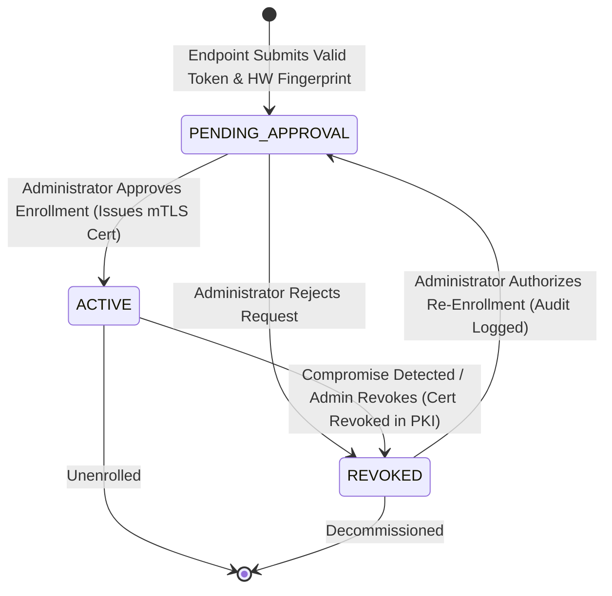

# BI ANTIVIRUS — SPRINT 5 CONTROLLED ENDPOINT ENROLLMENT SECURITY SPECIFICATION
**Subsystem:** Controlled Endpoint Enrollment & Identity Lifecycle  
**Files:** [`bi_antivirus/enterprise/enrollment_manager.py`](file:///D:/bit%20defender/bi_antivirus/enterprise/enrollment_manager.py), [`bi_antivirus/enterprise/fleet_database.py`](file:///D:/bit%20defender/bi_antivirus/enterprise/fleet_database.py)  
**Security Standard:** Bitdefender GravityZone Functional Parity — Zero-Trust Device Onboarding  
**Baseline Test Suite:** `bi_antivirus/tests/test_enrollment_security.py` (8/8 passing tests)

---

## 1. Threat Model & Design Goals

In corporate enterprise deployments, naive endpoint auto-registration creates critical vulnerabilities:
1. **Rogue Endpoint Injection:** An attacker on the local network guesses or leaks a shared installer token and registers an unauthorized device to receive internal policies or inject forged telemetry.
2. **Device Spoofing & Identity Hijacking:** A rogue workstation claims the identifier of an existing legitimate server or executive laptop to intercept targeted policy configurations.
3. **Zombie Endpoint Re-attachment:** A device that was revoked following malware compromise or theft re-enrolls automatically using stale installer artifacts.

To mitigate these threats, BI Antivirus Sprint 5 establishes a **Controlled Enrollment State Machine** with mandatory administrator approval gates and hardware fingerprint binding.

---

## 2. Enrollment Lifecycle State Machine



### 2.1 State Definitions
- **`PENDING_APPROVAL`**: Device is staged in the directory. No mTLS certificate is issued. Device cannot fetch policies or submit EDR telemetry.
- **`ACTIVE`**: Administrator has validated device provenance. X.509 client certificate issued with CN matching `endpoint_id`. Endpoint is authorized for full mTLS communication.
- **`REVOKED`**: Endpoint isolation or decommission. Certificate is permanently revoked in PKI and SQLite CRL. Any attempt to communicate is aborted at the TLS layer.

---

## 3. Hardware Fingerprinting & Collision Prevention

To detect identity spoofing, each endpoint computes a deterministic identity fingerprint:

$$\text{Fingerprint} = \text{SHA-256}\Big(\text{hostname}_{\text{lower}} \parallel \text{"|"} \parallel \text{mac\_address}_{\text{lower}} \parallel \text{"|"} \parallel \text{os\_version}\Big)$$

When an enrollment request arrives:
1. **Master Token Verification:** Constant-time verification (`hmac.compare_digest`) against the master enrollment key.
2. **Duplicate Check:**
   - If `endpoint_id` is new: Registered with status `PENDING_APPROVAL`.
   - If `endpoint_id` exists and is `ACTIVE`:
     - Compares existing hardware fingerprint against incoming fingerprint.
     - If fingerprints **mismatch**: Rejects request immediately with `DUPLICATE_IDENTITY_MISMATCH` and raises a security alert.
     - If fingerprints **match**: Returns existing status (`ALREADY_ACTIVE`).
   - If `endpoint_id` exists and is `REVOKED`:
     - Rejects request with `REVOKED_ENDPOINT_CANNOT_REENROLL`.

---

## 4. Administrative Controls & Audit Trail

All enrollment operations require valid administrator credentials (`admin_token`) and record immutable records in `fleet_audit_log`:

```json
{
  "audit_id": "AUD-F4A1B2C3D4E5",
  "admin_id": "sec_admin",
  "action": "ENROLLMENT_APPROVED",
  "target_type": "ENDPOINT",
  "target_id": "EP-OPS-01",
  "timestamp": 1729000000.0,
  "details": {
    "hostname": "OPS-LAPTOP",
    "cert_issued": "D:\\bit defender\\data\\pki\\certs\\client_EP-OPS-01.crt"
  },
  "auth_token_hash": "a591a6d40bf420404a011733cfb7b190d62c65bf0bcda32b57b277d9ad9f146e"
}
```

---

## 5. Verification and Test Results

| Test Case | Scenario Tested | Outcome | Duration |
|:---|:---|:---:|:---:|
| `test_01_request_enrollment_pending` | Request with valid token enters PENDING_APPROVAL | PASS | 0.40s |
| `test_02_invalid_token_rejection` | Forged token rejected immediately | PASS | 0.01s |
| `test_03_admin_approval_and_cert` | Admin approval transitions to ACTIVE and generates client cert | PASS | 0.41s |
| `test_04_duplicate_spoof_detection` | Same ID with mismatched MAC rejected as duplicate spoof | PASS | 0.42s |
| `test_05_endpoint_revocation` | Revocation marks REVOKED and invalidates cert in PKI | PASS | 0.41s |
| `test_06_revoked_cannot_reenroll` | Revoked device blocked from re-enrolling until authorized | PASS | 0.42s |
| `test_07_unauthorized_admin_token` | Operations with forged admin token fail | PASS | 0.01s |
| `test_08_auto_approve_mode` | Optional auto-approve mode immediately provisions credentials | PASS | 0.39s |

**Total Enrollment Security Tests:** 8/8 Passed (100% success).
