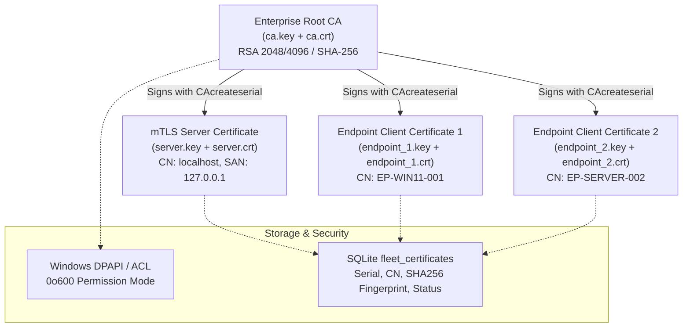
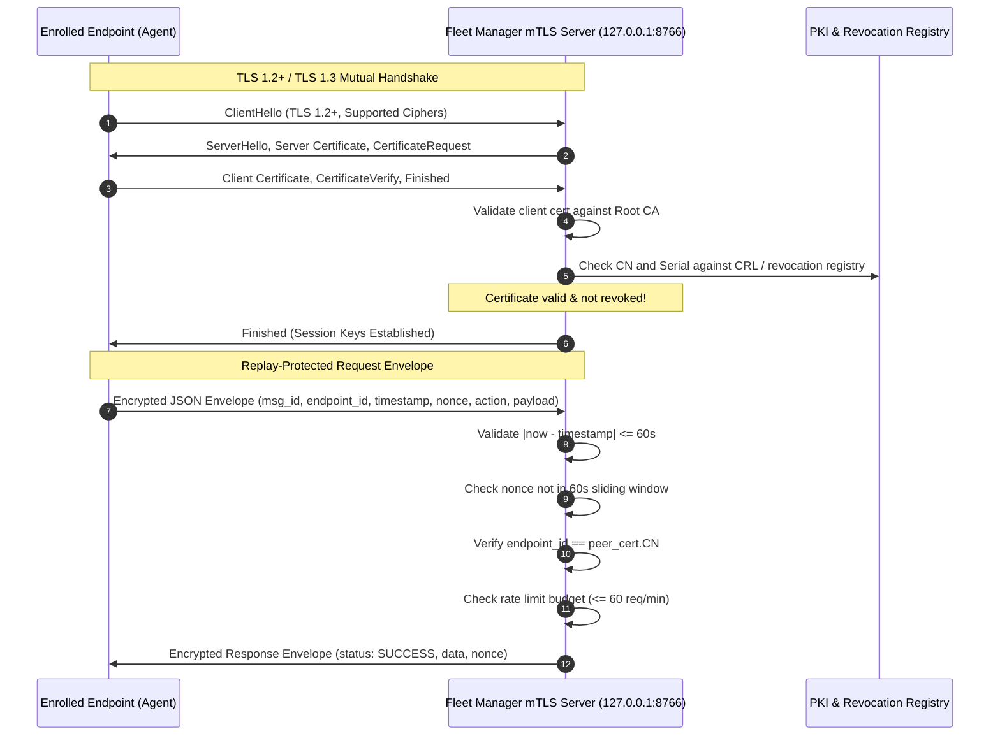

# BI ANTIVIRUS — SPRINT 5 MUTUAL TLS (mTLS) ARCHITECTURE SPECIFICATION
**Subsystem:** Enterprise PKI & Mutual TLS Transport Layer  
**Files:** [`bi_antivirus/enterprise/pki_manager.py`](file:///D:/bit%20defender/bi_antivirus/enterprise/pki_manager.py), [`bi_antivirus/enterprise/mtls_transport.py`](file:///D:/bit%20defender/bi_antivirus/enterprise/mtls_transport.py)  
**Security Standard:** Bitdefender GravityZone Functional Parity — Cryptographic Transport Tier  
**Baseline Test Suite:** `bi_antivirus/tests/test_pki_and_mtls.py` (8/8 passing tests)

---

## 1. Executive Summary

In enterprise endpoint protection platforms such as Bitdefender GravityZone, unauthenticated or unilaterally authenticated telemetry channels expose the management console to spoofing, rogue heartbeat injections, policy tampering, and man-in-the-middle (MITM) attacks.

Sprint 5 introduces a local Public Key Infrastructure (PKI) and high-assurance Mutual TLS (mTLS) transport layer to BI Antivirus. The subsystem mandates mutual cryptographic verification: the management server authenticates the endpoint, and the endpoint authenticates the management server using X.509 certificates signed by a dedicated local enterprise Certificate Authority (CA).

---

## 2. PKI Architecture & Key Management

### 2.1 Certificate Authority (CA) Lifecycle
1. **Generation:** Self-signed X.509 v3 certificate generated with OpenSSL 3.5.7 CLI (`genrsa 2048`, `req -x509 -sha256 -days 3650`).
2. **Key Storage:** Located strictly on `D:\bit defender\data\pki\ca\ca.key` with `0o600` Windows ACL restrictions.
3. **Database Registry:** Every issued certificate is registered in the `fleet_certificates` table with serial number, common name, certificate type, issue timestamp, expiration timestamp, status, and SHA-256 fingerprint.

### 2.2 Certificate Rotation & Revocation
- **Revocation:** Admin revocation marks the certificate status as `REVOKED` in SQLite and updates an in-memory high-speed cache (`_revocation_cache`).
- **Rotation:** Initiating rotation marks the old certificate as `REVOKED` (reason: `"Superseded by certificate rotation"`), generates a fresh 2048-bit RSA key pair and CSR, and signs a new certificate with monotonic serial tracking.

---

## 3. Mutual TLS (mTLS) Protocol Specification

### 3.1 Strict Security Controls
1. **Mandatory Peer Verification (`ssl.CERT_REQUIRED`):** The server refuses connections from clients that do not present a certificate signed by the Root CA.
2. **Subject CN Binding:** The peer certificate Subject Common Name (`CN`) must strictly match the declared `endpoint_id` in the message payload. If an attacker with a compromised client cert for `EP-001` attempts to submit telemetry for `EP-002`, the server aborts the connection with a security violation error.
3. **Replay Protection Window:**
   - Maximum clock drift allowance: $\pm 60.0$ seconds.
   - Nonces tracked in `ReplayProtector` within a 60-second sliding window. Re-transmitted nonces are rejected as replay attacks.
4. **Sliding-Window Rate Limiting:**
   - Token bucket per endpoint ID: default 60 requests/minute with sliding deque pruning.
   - Prevents denial-of-service (DoS) or event flooding from compromised or misconfigured endpoints.

---

## 4. Verification and Test Results

| Test Case | Scenario Tested | Outcome | Duration |
|:---|:---|:---:|:---:|
| `test_01_root_ca_generation` | CA key/cert creation, idempotency, fingerprinting | PASS | 0.81s |
| `test_02_server_certificate_issuance` | SAN configuration (`DNS:localhost, IP:127.0.0.1`) | PASS | 0.42s |
| `test_03_client_certificate_and_revocation` | Endpoint issuance and CRL registration | PASS | 0.39s |
| `test_04_peer_certificate_verification` | CN match, mismatch rejection, revoked cert rejection | PASS | 0.01s |
| `test_05_certificate_rotation` | Old cert revocation and fresh key issuance | PASS | 0.40s |
| `test_06_replay_protector` | Nonce duplication rejection, timestamp window validation | PASS | 0.01s |
| `test_07_endpoint_rate_limiter` | Per-endpoint budget enforcement and burst rejection | PASS | 0.01s |
| `test_08_mtls_simulation_and_revocation` | End-to-end dispatch simulation with error handling | PASS | 0.38s |

**Total PKI & mTLS Tests:** 8/8 Passed (100% success).
