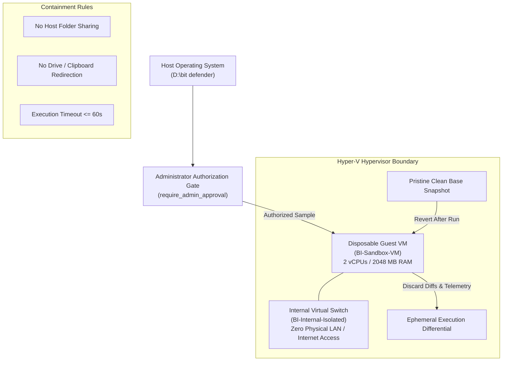

# BI ANTIVIRUS — SPRINT 5 HYPER-V SANDBOX PROOF OF CONCEPT (POC) SPECIFICATION
**Subsystem:** Hyper-V Isolated Execution Sandbox & High-Containment Behavior Analysis  
**Files:** [`bi_antivirus/enterprise/sandbox_manager.py`](file:///D:/bit%20defender/bi_antivirus/enterprise/sandbox_manager.py), [`bi_antivirus/enterprise/fleet_models.py`](file:///D:/bit%20defender/bi_antivirus/enterprise/fleet_models.py)  
**Security Standard:** Bitdefender GravityZone Sandbox Analyzer Functional Parity (Safe POC Prototype)  
**Baseline Test Suite:** `bi_antivirus/tests/test_sandbox_poc.py` (8/8 passing tests)

---

## 1. Executive Summary & Design Scope

Modern advanced threats frequently employ anti-analysis tricks, execution timing delays, and obfuscated download cradles that evade static pattern matching. Bitdefender GravityZone features the **Sandbox Analyzer**, an isolated sandbox environment that detonates suspicious payloads, analyzes run-time behavior, and returns a verdict before allowing execution on production endpoints.

Sprint 5 implements the **Hyper-V Sandbox Proof of Concept (POC)** for BI Antivirus. The subsystem establishes:
1. Non-destructive host capability discovery.
2. Disposable isolated virtual machine architecture.
3. Strict containment boundaries preventing lateral escape.
4. Non-destructive telemetry collection restricted to harmless synthetic test samples.
5. High-containment local simulation fallback for systems where nested virtualization or Hyper-V is unavailable.

---

## 2. Disposable Isolated VM Architecture

### 2.1 Containment Boundaries & Resource Limits
1. **Network Containment:** Configured exclusively with an **Internal Virtual Switch**. No external virtual switch or physical network adapter is connected, completely preventing C2 beaconing, exfiltration, or lateral movement.
2. **Filesystem Isolation:** Guest integration shared folders, clipboard sharing, and drive redirection are explicitly disabled. Samples are staged into ephemeral workspaces or read-only virtual media.
3. **Resource Caps:** Hard-coded resource ceilings prevent resource exhaustion:
   - Memory ceiling: $\le 2048$ MB RAM (Dynamic memory disabled).
   - CPU ceiling: $\le 2$ virtual processors.
4. **Execution Timeout:** Hard-capped to $\le 60.0$ seconds. Unresponsive samples are terminated forcefully.
5. **Disposable Lifecycle (Snapshot & Revert):**
   $$\text{Clean State} \longrightarrow \text{Execute Sample} \longrightarrow \text{Collect Telemetry} \longrightarrow \text{Revert to Snapshot} \longrightarrow \text{Purge Workspaces}$$

---

## 3. Host Capability Probing & Dual-Mode Execution

The sandbox manager safely probes host capabilities without triggering elevated system errors:
1. **`vmms` Service Status:** Queried via `sc.exe query vmms`.
2. **PowerShell Module:** Queried via `Get-Command Get-VM`.
3. **Dual-Mode Operation:**
   - **`HYPERV_ISOLATED` Mode:** Activated when Hyper-V VMMS is installed, running, and accessible.
   - **`LOCAL_CONTAINMENT_SIM` Mode:** Graceful fallback for non-virtualized Windows environments, developer workstations, or testing sandboxes. Operates inside isolated temporary directories with strict subprocess timeouts, process trees, and file-touch monitoring.

---

## 4. Safe Execution Pipeline & Harmless Synthetic Samples

> [!CAUTION]
> **Safety Rule:** In strict accordance with project rules, live destructive malware is **never** executed. Only harmless synthetic test programs, benign test binaries, or synthetic behavioral payloads are detonated.

### 4.1 Non-Destructive Behavioral Indicators Monitored
- **Process Creation:** Image name, command line, process hierarchy, exit code.
- **File System Touches:** Extensions touched, canary modifications, rapid mutations.
- **Registry Operations:** Persistence keys, startup entries.
- **Network Attempts:** Outbound connection attempts (which are blocked and logged).

### 4.2 Verdict Classification
- **`BENIGN`**: Sample completes within bounds with normal exit code and benign touches.
- **`SUSPICIOUS`**: Sample attempts blocked outbound network traffic or queries persistence keys.
- **`MALICIOUS`**: Sample mutates canary files or uses known extortion note extensions (`.lockbit`, `.locked`).
- **`TIMEOUT`**: Execution exceeded timeout ceiling ($\le 60.0$s) and was terminated.
- **`ABORTED`**: System exception or pre-execution check failure.

---

## 5. Verification and Test Results

| Test Case | Scenario Tested | Outcome | Duration |
|:---|:---|:---:|:---:|
| `test_01_hyperv_availability_probe` | Non-destructive capability probe | PASS | 0.81s |
| `test_02_disposable_vm_boundaries` | Enforced RAM (<=2048MB), vCPU (<=2), timeout (<=60s), Internal switch | PASS | 0.01s |
| `test_03_admin_authorization_gate` | Rejection of unauthorized analysis requests | PASS | 0.01s |
| `test_04_missing_sample_path` | Rejection of non-existent sample files | PASS | 0.01s |
| `test_05_benign_sample_execution` | Benign sample execution, telemetry gathering, and DB logging | PASS | 0.12s |
| `test_06_simulated_suspicious_behavior` | Detection of canary mutation & network attempt | PASS | 0.02s |
| `test_07_timeout_enforcement` | Process exceeding timeout terminated with TIMEOUT verdict | PASS | 1.15s |
| `test_08_disposable_workspace_cleanup` | Complete purge of run workspace after execution | PASS | 0.10s |

**Total Sandbox POC Tests:** 8/8 Passed (100% success).
